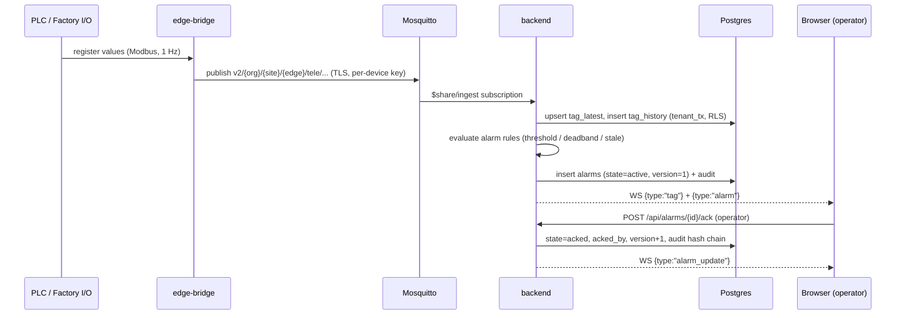
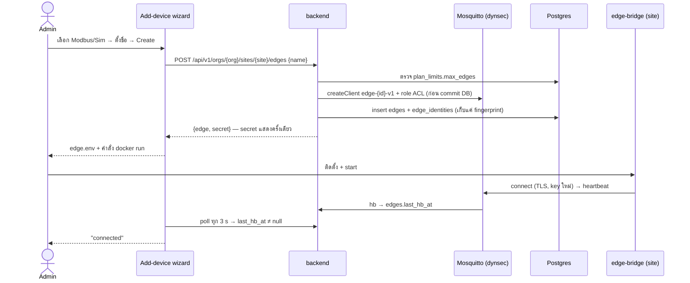
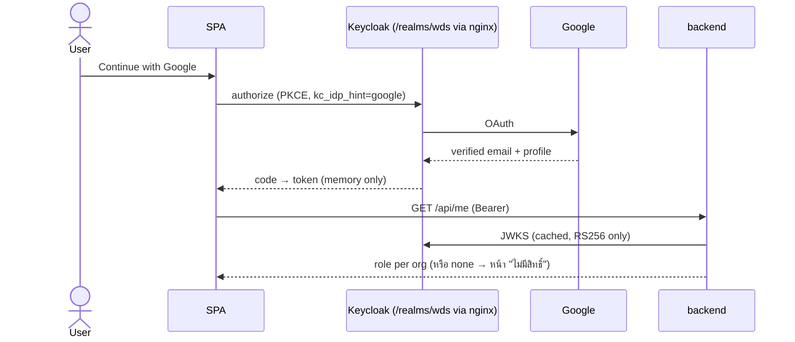
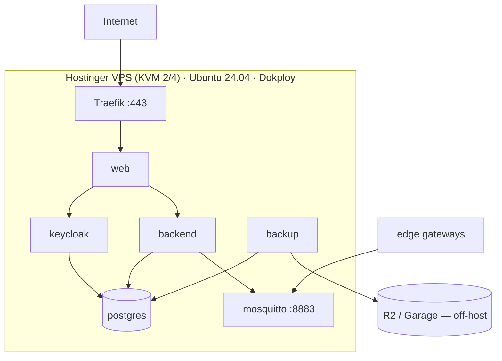
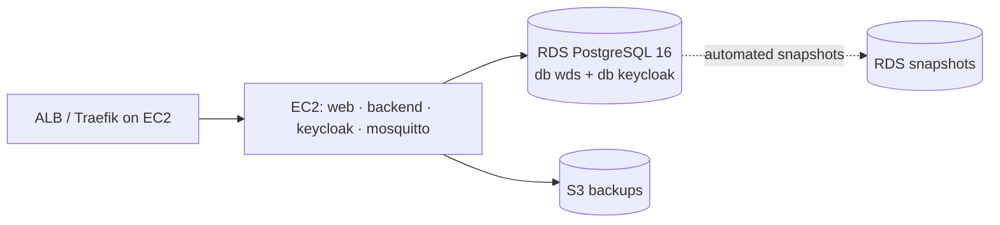

# 02 — Architecture & Tech Stack

## 1. System context (C4 level 1)

```mermaid
flowchart LR
  op["Operator / ช่าง<br/>(control room)"] -->|HTTPS| sys
  mgr["เจ้าของ / ผู้จัดการ"] -->|HTTPS| sys
  admin["ผู้ดูแลแพลตฟอร์ม"] -->|SSH · bootstrap CLI| sys
  sys["Plant Ops OS<br/>(console SaaS)"]
  edge["Edge gateway @ site<br/>PLC / Factory I/O + YOLO"] -->|MQTT/TLS 8883| sys
  sys -->|commands (simulator)| edge
  sys -->|OIDC broker| google["Google identity"]
  sys -->|pg_dump| s3["S3 storage<br/>(Garage / R2 / AWS S3)"]
  probe["Uptime probe"] -->|GET /api/health| sys
```

## 2. Container view (C4 level 2)

ไฟล์แก้ไขได้: [`diagrams/architecture.drawio`](diagrams/architecture.drawio)

| Container | Image / tech | หน้าที่ | Network |
|---|---|---|---|
| **web** | nginx 1.27 + React SPA (Vite build) | เสิร์ฟ SPA, CSP/security headers, real-IP, proxy same-origin `/api` `/ws` `/realms/wds` | หลัง Traefik; ไม่ publish port ใน prod |
| **backend** | Python 3.12 · FastAPI 0.139 · uvicorn | REST v1/v2, WebSocket (first-frame auth), alarm engine, insight engine, command outbox, dynsec reconciler, `/metrics` | ภายใน |
| **keycloak** | Keycloak 26.4 (`start`, DB = Postgres) | OIDC PKCE, Google broker, MFA | ภายใน (ผ่าน web) |
| **mosquitto** | Eclipse Mosquitto 2 + dynamic-security | MQTT TLS 8883, ACL ต่ออุปกรณ์ | **public 8883** |
| **postgres** | PostgreSQL 16-alpine | db `wds` (RLS) + db `keycloak` | ภายใน |
| **migrate** | backend image, one-shot | Alembic upgrade ในฐานะ `wds_owner` | ภายใน |
| **kc-sync** | backend image, one-shot | ตั้ง redirect URI ของ `wds-web` ตาม `PUBLIC_URL`, sync Google IdP | ภายใน |
| **backup** | postgres:16-alpine + rclone | `pg_dump -Fc` ของ `wds` + `keycloak` → S3 ตามรอบ, ลบเก่ากว่า N วัน | ออก S3 |
| **edge-bridge** | Python + paho-mqtt (+ pymodbus) | ที่ไซต์ลูกค้า: อ่าน PLC → publish tag, รับคำสั่ง, store-and-forward | ที่ไซต์ (ใน prod ปิด demo sim ด้วย profile) |

## 3. Key runtime flows (sequence)

### 3.1 Telemetry → แอลาร์ม → operator ack



### 3.2 เพิ่มอุปกรณ์ของลูกค้า (device onboarding)



### 3.3 Sign-in (OIDC PKCE + Google broker)



### 3.4 Command (เฉพาะไซต์ simulator)

ขั้นตอนตาม doc 16 (command safety contract): confirm ใน UI → `POST /api/commands` (operator, rate limit, idempotency key, TTL)
→ `command_outbox` → MQTT `cmd/` → edge ตอบ `cmd-resp` → `command_events` (accepted→dispatched→acknowledged | rejected | timeout | failed) → WS `command`
ไซต์ที่ `control_enabled=false` ปฏิเสธฝั่ง server

## 4. Tech stack + เหตุผล

| ชั้น | เทคโนโลยี (เวอร์ชันจริง) | เหตุผลที่เลือก | ทางเลือกที่ไม่เลือก |
|---|---|---|---|
| Frontend framework | React 19.2 + TypeScript 6.0 + Vite 8 | ทีมใช้อยู่, ecosystem ใหญ่, build เร็ว | Next.js — ไม่ต้องการ SSR, ทำให้ same-origin proxy ซับซ้อน |
| Styling | Tailwind CSS 4.3 + token CSS (`dd-theme.css`) | dense UI แบบ console, token เดียวทั้งระบบ | UI kit สำเร็จรูป — ไม่ได้ความหนาแน่นแบบ Datadog |
| Server state | TanStack Query 5 | cache/refetch/poll มาตรฐาน | Redux — เกินความจำเป็น |
| Live state | store เอง (`lib/live.ts`) + WebSocket | ring buffer 3600 จุด/tag, rAF flush | — |
| Charts | uPlot 1.6 | เร็วมากกับข้อมูล time series หนาแน่น | Recharts/ECharts — หนักกว่า |
| Dashboard grid | react-grid-layout 2.2.4 (MIT) | drag/resize + keyboard size fallback | gridstack — API ไม่ใช่ React-first |
| Icons | lucide-react 1.48 (ISC) | ฟรีเชิงพาณิชย์, tree-shake | ไอคอน druids ของ Datadog — ห้ามขาย |
| 3D | three 0.186 | ผังไลน์ 3D (lazy route) | — |
| i18n | i18next + react-i18next | ไทย/อังกฤษ | — |
| Auth (client) | oidc-client-ts 3.5 | PKCE มาตรฐาน | — |
| Backend | Python 3.12 · FastAPI 0.139 · uvicorn 0.51 · pydantic 2.13 | async, WS, ทีมถนัด Python (YOLO อยู่ฝั่ง Python ด้วย) | Node — แยกภาษาจากงาน AI |
| DB driver / migration | asyncpg 0.31 · Alembic 1.20 · SQLAlchemy 2.0 (เฉพาะ migration) | เร็ว, RLS ผ่าน `set_config` ต่อ transaction | ORM เต็มรูป — ไม่จำเป็น |
| MQTT client | paho-mqtt 2.1 | มาตรฐาน | — |
| Identity | Keycloak 26.4 | OIDC/SAML/MFA/social login ในตัว, self-host | Auth0/Clerk — ค่าใช้จ่ายต่อผู้ใช้ + ข้อมูลออกนอก |
| Broker | Mosquitto 2 + dynsec | เบา, ACL ต่อ client แบบ dynamic | EMQX — หนักกว่าสำหรับ 1 VPS; AWS IoT Core — ดู §7 |
| DB | PostgreSQL 16 | RLS, LISTEN/NOTIFY, jsonb | TimescaleDB — เพิ่มได้ภายหลังถ้า history โต |
| Observability | prometheus-client `/metrics` (+ Grafana แนะนำ) + uptime probe ภายนอก | มาตรฐาน | — |
| Deploy | Docker Compose + Dokploy (Traefik, Let's Encrypt) | compose เดิมใช้ได้ตรง ๆ, UI deploy + webhook | k8s — เกินขนาดทีม/ระยะเวลา |
| Backup | pg_dump + rclone → S3 (Garage / R2 / AWS S3) | มาตรฐาน S3 ย้ายผู้ให้บริการได้ | volume snapshot — ไม่ consistent สำหรับ Postgres ที่กำลังรัน |
| AI model | YOLO (Aggregate_Project) บน local PC = edge device; HF Spaces เป็นทางเลือก | ไม่ต้องมี GPU บน server | รันใน backend — กิน CPU/RAM ของ VPS |

## 5. Configuration contract (env)

| Var | ใช้ที่ | ตัวอย่าง prod |
|---|---|---|
| `PUBLIC_URL` | keycloak hostname, backend CORS/origins/issuer, kc-sync | `https://ops.example.com` |
| `SECRETS_DIR` / `CERTS_DIR` | compose secrets & cert mounts | `../files/secrets` / `../files/certs` (Dokploy) |
| `MQTT_PUBLIC_HOST` | SAN ของ broker cert (`gen-certs.sh`) | `mqtt.example.com` |
| `BACKUP_S3_ENDPOINT` / `BACKUP_S3_BUCKET` / `BACKUP_KEEP_DAYS` | backup | R2/Garage endpoint |
| `GOOGLE_CLIENT_ID` / `GOOGLE_CLIENT_SECRET` | kc-sync, backend `/api/auth/config` | ว่าง = ปิด |
| `BACKEND_PORT`, `COMPOSE_SUBNET`, `WEB_IP`, `TRUSTED_PROXIES` | เครื่อง dev / หลายโปรเจกต์บน host เดียว | ค่าเริ่มต้นเดิม |
| `VITE_FEATURES` | build ของ web (feature flags) | `dashboards,slos,...` (ต้องสร้าง — 06) |

## 6. Deployment options

### 6.1 Option A — VPS + Dokploy (**ตัวหลัก 20 ต.ค.**)



- Compose command (Dokploy → Advanced → Command):
  `compose -p plantops -f docker-compose.yml -f docker-compose.prod.yml up -d --build --remove-orphans`
- Secrets/certs วางใน `../files/` (File Mounts) เพราะ Dokploy `git clone` ใหม่ทุก deploy
- Domain: Dokploy Domains → service `web` port 80 (Traefik + Let's Encrypt)
- เปิด firewall: 22 (จำกัด IP), 80/443, 8883
- **ทดสอบแล้วบนเครื่อง dev (overlay จริง):** Keycloak prod บน Postgres, kc-sync, migrate, backup → Garage จริง, backend prod gate, dev token ถูกปฏิเสธ, master realm ไม่ถูก expose

### 6.2 Option B — AWS ระดับ 1 (EC2 + compose)

เหมือน Option A แทบทั้งหมด: EC2 `t3.large` (2 vCPU/8 GB) + EBS gp3 40 GB, Security Group เปิด 443/8883,
Caddy/Traefik หรือ Dokploy บน EC2, `BACKUP_S3_ENDPOINT=https://s3.<region>.amazonaws.com` + IAM user ที่เขียนได้เฉพาะ bucket
**ต้นทุนประมาณ** $60–70/เดือน → เครดิต $100 อยู่ได้ ~1–1.5 เดือน (ประเมิน ไม่ได้เช็คราคาสด)

### 6.3 Option C — AWS ระดับ 2 (EC2 + RDS + S3)



สิ่งที่ต้องเตรียม (ผลกระทบปานกลาง):

1. overlay `docker-compose.aws.yml`: ปิด service `postgres` (`profiles: [local-db]`), ชี้ `WDS_*_DSN`/`KC_DB_URL` ไป endpoint RDS, `sslmode=require`
2. RDS ไม่รัน `docker-entrypoint-initdb.d` → รัน `infra/postgres/init/01-roles.sh` + `02-keycloak.sh` ครั้งเดียวด้วย master user
3. RLS + `LISTEN/NOTIFY` + role ที่ไม่ใช่ superuser ใช้ได้บน RDS (ไม่ต้องใช้ BYPASSRLS)
4. backup เปลี่ยนเป็น RDS automated snapshot + pg_dump เดิม (คู่กัน)

### 6.4 Option D — Frontend บน Vercel (+ core บน A/B/C)

| ประเด็น | วิธีทำ |
|---|---|
| same-origin `/api` และ `/realms/wds` | `vercel.json` rewrites → `https://api.example.com/...` (Vercel proxy ฝั่ง server; browser ยังเห็นโดเมนเดียว) |
| WebSocket | rewrite ของ Vercel **ไม่รองรับ WS** → SPA ต่อ `wss://api.example.com/ws` ตรง: เพิ่ม `VITE_WS_URL`, ใส่โดเมน Vercel ใน `ALLOWED_ORIGINS` (backend ใช้ first-frame auth อยู่แล้ว token ไม่อยู่ใน URL) |
| Security headers | ย้าย CSP/HSTS/nosniff จาก `nginx.conf` ไป `vercel.json` headers; `connect-src` เพิ่ม `wss://api.example.com` |
| Keycloak hostname | `PUBLIC_URL` = โดเมน Vercel (issuer ต้องตรงกับ authority ที่ browser เห็น) |
| สิ่งที่อยู่ Vercel ไม่ได้ | backend (realtime/WS/MQTT), Keycloak, Mosquitto, Postgres |

## 7. Evolution path

| เมื่อ | เปลี่ยน | ทำไม |
|---|---|---|
| > 1 VPS รับไม่ไหว / ต้อง 99.9 % | Option C + RDS Multi-AZ + EC2 2 ตัวหลัง ALB (backend stateless ยกเว้น WS sticky) | HA |
| history > 8 ชม. | TimescaleDB hypertable + continuous aggregates หรือ export ไป S3/Parquet | historian |
| อุปกรณ์หลักพัน | EMQX cluster หรือ AWS IoT Core (เขียน provisioning ใหม่เป็น X.509 + IoT policy) | scale broker |
| LINE OA | notification service อ่าน `alarm` events → LINE Messaging API | future |
| OPC UA / S7 | adapter ใหม่ใน edge-bridge (interface เดิม `adapters/base.py`) | ลูกค้าที่ไม่ใช่ Modbus |
