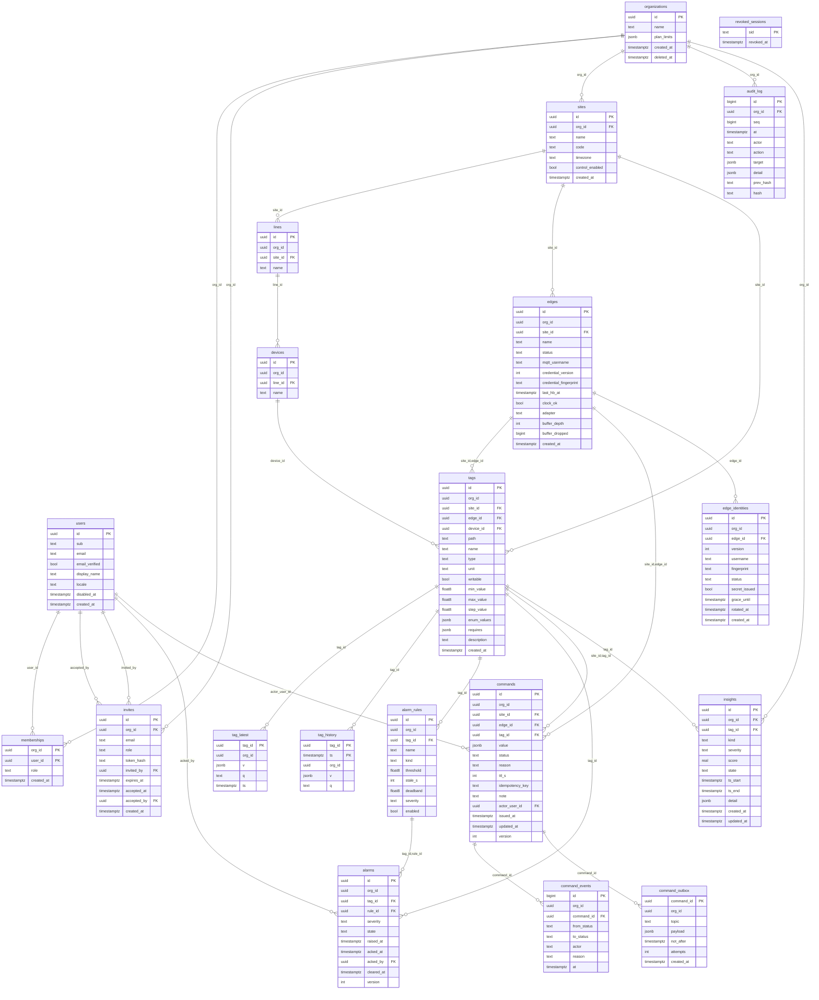
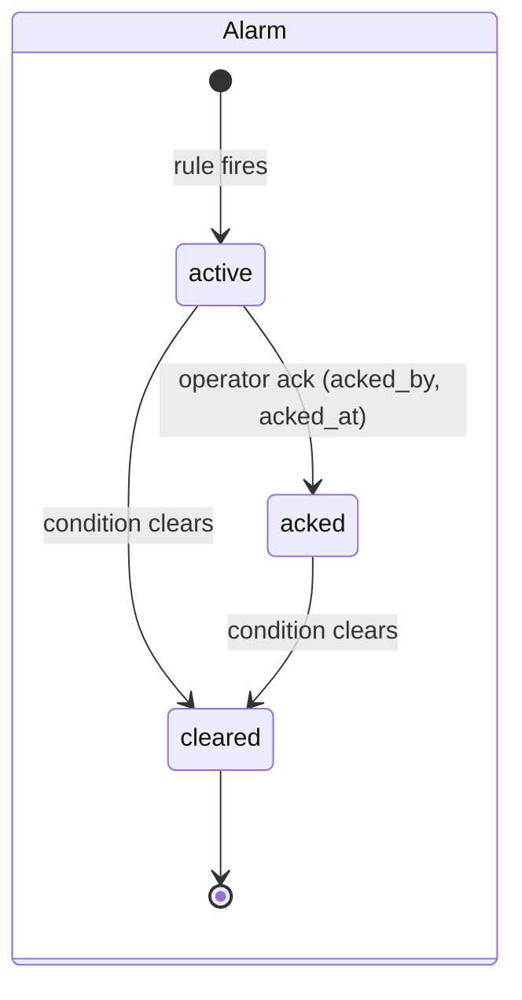
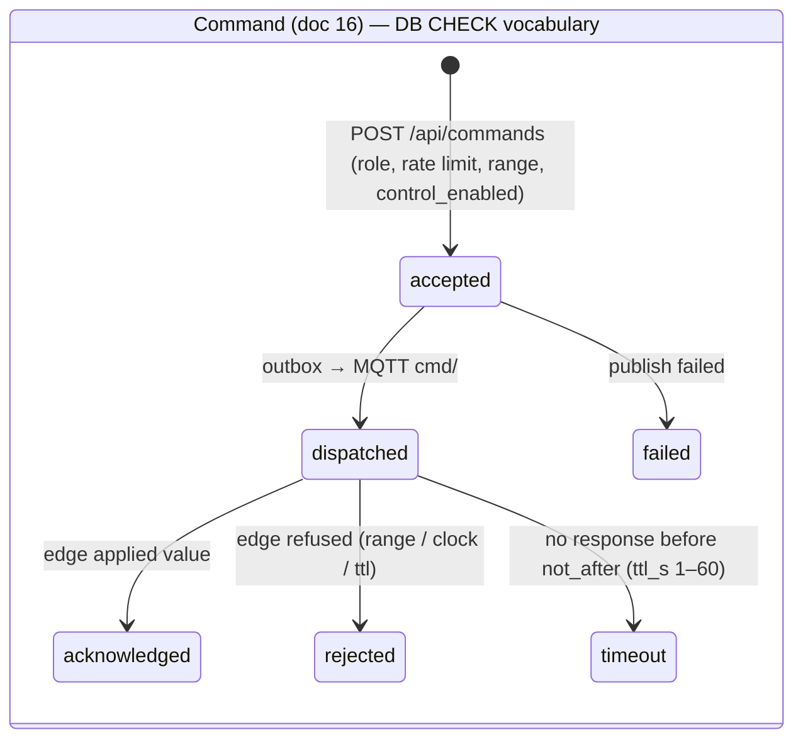
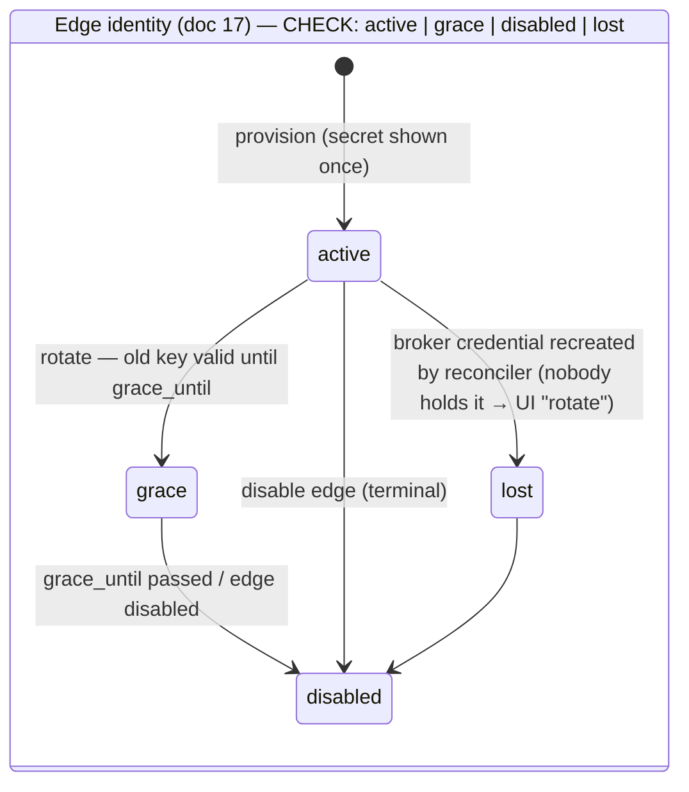

# 03 — Data Model

> แหล่งความจริง: schema ที่รันอยู่ (`diagrams/schema.sql` = `pg_dump -s`, Alembic head) — ERD ด้านล่าง **สร้างจาก Postgres catalog**
> ไม่ได้วาดเอง (20 ตาราง, 27 foreign key) สร้างใหม่ได้ด้วยคำสั่งใน §7

## 1. Domains

| Domain | ตาราง | หมายเหตุ |
|---|---|---|
| Identity & tenancy | `users`, `memberships`, `invites`, `revoked_sessions` | `users` เป็น global (ไม่มี org_id); `memberships` คือ role ต่อ org |
| Organization & plant | `organizations`, `sites`, `lines`, `devices` | `organizations.plan_limits` (jsonb) = โควตา; `sites.control_enabled` = เปิด/ปิดการสั่งงาน |
| Edge & tag registry | `edges`, `edge_identities`, `tags` | อุปกรณ์ edge + key MQTT ทุกเวอร์ชัน (เก็บ fingerprint); `tags` มี min/max/step สำหรับ validate คำสั่ง |
| Telemetry & AI | `tag_latest`, `tag_history`, `insights` | `tag_history` (tag_id, ts) PK; `insights` = ผลวิเคราะห์ rule-based (anomaly/drift/flatline/flapping) |
| Alarms | `alarm_rules`, `alarms` | `alarms.version` เรียงลำดับ transition |
| Commands & audit | `commands`, `command_events`, `command_outbox`, `audit_log` | outbox pattern; audit เป็น hash chain ต่อ org |

## 2. ERD (ฉบับเต็ม)



## 3. Multi-tenancy rules (ADR-13)

1. ทุกตาราง tenant มี `org_id` และเปิด **RLS** (18 ตาราง) — policy อ่าน `current_setting('app.org_id')`
   ที่ backend ตั้งด้วย `set_config(..., true)` ภายใน transaction (`tenant_tx`)
2. FK เป็นแบบ **composite** `(org_id, …)` → แถวลูกอ้างอิงแถวของ org อื่นไม่ได้แม้ RLS จะพลาด (defense in depth)
3. Role แยก: `wds_owner` (migration เท่านั้น) · `wds_app` (API, NOBYPASSRLS) · `wds_system` (worker, lookup ข้าม org แบบจำกัด) — app ไม่มี superuser
4. นอก tenant transaction (`global_tx`) เห็นเฉพาะตาราง global (`users`, `revoked_sessions`) — CLI `app.bootstrap`
   จึงใช้ org id แบบ deterministic (uuid5 ของชื่อ) แทนการค้นข้าม tenant

## 4. State machines





API v1 (หน้าเว็บเดิม) แปลงชื่อสถานะเป็น `issued · sent · acked · done · denied · failed · timeout`
(accepted→issued, dispatched→sent, acknowledged→acked/done, rejected→denied)



## 5. Audit log (tamper-evident)

`audit_log(org_id, seq, at, actor, action, target, detail, prev_hash, hash)` — แต่ละแถวเก็บ hash ของแถวก่อนหน้าใน org เดียวกัน
→ แก้/ลบแถวกลางทางจะทำให้ chain แตก ตรวจด้วย `make verify-audit` (ทำหลัง restore ทุกครั้ง)
เหตุการณ์ที่บันทึก: ack, command, rule CRUD, membership/invite, edge provision/rotate/disable, export

## 6. Retention & growth

| ตาราง | อัตราโต (10 อุปกรณ์ × 50 tag × 1 Hz) | นโยบาย |
|---|---|---|
| `tag_history` | ~43 ล้านแถว/วัน | ออกแบบเก็บ 8 ชม. — **ต้องเพิ่ม prune job** (ลบ `ts < now() - 8h` ทุก 5 นาที) ก่อนใช้งานยาว; ระยะยาว → TimescaleDB |
| `alarms`, `command_events`, `audit_log` | ต่ำ | เก็บถาวร (audit ห้ามลบ) |
| `insights` | ต่ำ | เก็บถาวร; state closed |

> ข้อสังเกต: 43 ล้านแถว/วันบน VPS เดียวหนักเกินไปถ้าไม่ prune — นี่คือความเสี่ยงอันดับต้นของ go-live (06 §2)

## 7. Regenerate

```bash
docker compose exec -T postgres pg_dump -U postgres -d wds -s --no-owner --no-privileges > SDLC/datadog/design/diagrams/schema.sql
# ERD: query pg_constraint (contype='f') + information_schema.columns → diagrams/erd.mmd (ดูสคริปต์ใน 05 §8)
```
