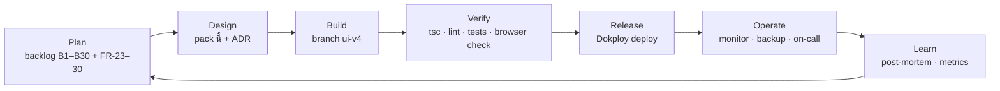

# 05 — SDLC, Quality & Operations

## 1. Process model

Iterative, เส้นทางสั้น (ทีมเล็ก + ผู้ช่วย AI): **Plan → Design → Build → Verify → Release → Operate → Learn**
ทุก increment ต้อง *deploy ได้* และซ่อนสิ่งที่ยังไม่เสร็จด้วย feature flag แทนการค้าง branch นาน

## 2. Environments

| Env | ที่ไหน | ข้อมูล | Auth | ใช้ทำอะไร |
|---|---|---|---|---|
| **dev** | เครื่องนักพัฒนา, `docker compose up` (+ Vite :5199) | seed Demo + edge sim | dev token + Keycloak | พัฒนา |
| **dev-mock** | Vite `MOCK_API=1` | mock ใน `web/mock/devApi.ts` | dev token | งาน UI ที่ไม่มี backend |
| **prod-test** | เครื่อง dev, `-p wds-prodtest` + prod overlay + `test-ports.yml` | สะอาด, secret สุ่ม, Garage จริง | Keycloak prod mode | ซ้อม deploy (ทำแล้ว 2026-10-15) |
| **prod** | VPS + Dokploy (หรือ AWS) | ลูกค้าจริง | Keycloak + Google | ใช้งานจริง |

## 3. Branching & change control

- branch งาน: `ui-v4` (ปัจจุบัน) → merge เข้า `main` เมื่อผ่าน gate; Dokploy deploy จาก `main` ผ่าน webhook
- commit ขนาดเล็ก ข้อความแบบ conventional (`feat(web): …`, `fix(backend): …`)
- เปลี่ยน schema = Alembic migration ใหม่เท่านั้น (ไม่แก้ migration เก่า), รันด้วย job `migrate` ก่อน backend
- เปลี่ยน contract API = อัปเดต `CONTRACT.v2.md` + test contract ใน PR เดียวกัน

## 4. Quality gates & test strategy

| ชั้น | อะไร | เครื่องมือ / คำสั่ง | Gate |
|---|---|---|---|
| Static | type, lint | `npx tsc -b` · `npx oxlint` | 0 error |
| Unit / contract (backend) | config, auth, idps, redirect-URI sync, ฯลฯ | `cd tests && pytest -m "not integration"` | ผ่านทั้งหมด (ต้องมี `asyncpg` ใน env) |
| Tenancy / RLS | cross-org isolation จริงบน DB | `make test-db` (stack test) | ผ่าน |
| Integration | REST + WS + MQTT TLS end-to-end | CI job `integration` (`.github/workflows/ci.yml`) | ผ่าน |
| Security | BOLA, auth bypass, RBAC, 429, headers, WS | `make test-security` | ผ่าน |
| Performance | history p95, WS fan-out, bundle size, LCP | `make test-perf` | ตามเกณฑ์ใน doc 20 |
| UAT (browser) | flow ผู้ใช้หลัก, 0 console error, 0 HTTP ≥ 400 | `tests/e2e/uat.mjs` (Playwright) | ผ่าน — **ต้องอัปเดตจำนวนเมนู** (เมนูใหม่เพิ่มแล้ว) |
| Visual check | หน้าใหม่ทุกหน้า | headless Chrome screenshot + ตรวจด้วยตา | ไม่มี overlap/clip/ค่าผิด |
| Deploy rehearsal | prod overlay บนเครื่องแยก | `docker compose -p wds-prodtest -f docker-compose.yml -f docker-compose.prod.yml …` | ทุก service healthy |

**Definition of Done (ต่อฟีเจอร์):** ผ่าน gate ข้างบนที่เกี่ยวข้อง · ข้อความไทย/อังกฤษครบ · สถานะ loading/empty/error ครบ ·
ตรวจในเบราว์เซอร์จริง · ถ้ายังใช้ข้อมูลจำลอง → ป้าย demo + flag ปิดใน prod · อัปเดตเอกสารที่ได้รับผล

## 5. Release & rollback

1. Pre-deploy: CI เขียว · migration ทดสอบบน prod-test · backup ล่าสุดสำเร็จ (ดู log `backup`)
2. Deploy: Dokploy → Deploy (build ใหม่, `migrate` → `kc-sync` → backend healthy (start_period 180 s) → web)
3. Smoke (5 นาที): `GET /api/health` = ok · sign-in ด้วยบัญชีจริง · Overview แสดงค่าสด · ไม่มี error ใน log
4. **Rollback triggers:** health ไม่ ok > 5 นาที · sign-in ใช้ไม่ได้ · error rate 5xx > 1 % · ข้อมูลข้าม org (หยุดทันที)
5. **Rollback:** Dokploy → redeploy commit ก่อนหน้า; ถ้า migration ไม่ย้อนได้ → restore จาก backup (§6) แล้ว `make verify-audit`

## 6. Backup & disaster recovery

| รายการ | ค่า |
|---|---|
| สิ่งที่ backup | db `wds` + db `keycloak` (`pg_dump -Fc`) |
| ความถี่ / เก็บ | ทุก 24 ชม. (`BACKUP_INTERVAL_S`) / 30 วัน (`BACKUP_KEEP_DAYS`) |
| ปลายทาง | S3 **นอกเครื่อง**: Garage (`deploy/garage/`) หรือ Cloudflare R2 / AWS S3 |
| ทดสอบแล้ว | upload ไป Garage จริงสำเร็จ (prod-test 2026-10-15) |
| Restore drill | `RESTORE_CONFIRM=1 make restore DUMP=…` → `make verify-audit` — **ทำ 1 ครั้งก่อน go-live** |
| Secrets/certs | เก็บสำเนาแยก (password manager) — ไม่อยู่ใน backup DB |
| ข้อจำกัด | Garage ไม่มี Object Lock → ป้องกัน ransomware ลบ backup ไม่ได้; ใช้ key ที่เขียนได้เฉพาะ bucket |

## 7. Monitoring & alerting (Operate)

| สิ่งที่ดู | เครื่องมือ | แจ้งเตือนเมื่อ |
|---|---|---|
| ระบบขึ้นอยู่ไหม (จากภายนอก) | uptime probe (บริการภายนอก) → `GET /api/health` ทุก 1 นาที | down > 2 นาที → อีเมล |
| tag/WS/engine/DB pool | Prometheus scrape `/metrics` + Grafana (แนะนำเพิ่ม) | ค่าผิดปกติ |
| ดิสก์ / RAM / restart loop | node-exporter / Dokploy monitoring | ดิสก์ > 80 %, RAM โตต่อเนื่อง, restart > 3/ชม. |
| backup | log ของ `backup` | ไม่มี "backup ok" ใน 26 ชม. |
| cert หมดอายุ | Let's Encrypt auto (Traefik); broker cert (10 ปี self-signed) | < 14 วัน |
| `tag_history` โต | `pg_total_relation_size` | > 70 % ของดิสก์ |

**Runbook ย่อ:** ระบบล่ม → ดู Dokploy logs → `docker compose ps` → restart service → ถ้า DB เสีย → restore §6 →
บันทึก post-mortem (skill `post-mortem`) ภายใน 48 ชม.

## 8. Tooling ที่ใช้สร้างเอกสารนี้ (reproducible)

| สิ่งที่สร้าง | วิธี |
|---|---|
| `diagrams/schema.sql` | `pg_dump -s --no-owner --no-privileges` |
| `diagrams/erd.mmd` | query `pg_constraint` (FK, รวม composite) + `information_schema.columns` + PK → Mermaid `erDiagram` |
| `diagrams/architecture.drawio` | เขียนด้วยมือ (drawio skill), ตรวจด้วย `validate.py` + render ผ่าน viewer + ตรวจด้วยตา 2 รอบ |
| sequence / state / deployment | Mermaid ในเอกสาร |

## 9. Roadmap หลัง go-live

| Phase | งาน |
|---|---|
| ต.ค.–พ.ย. (เสถียร) | prune `tag_history` · ย้าย dashboards ไปเก็บที่ backend · แทนไอคอน druids · role `maintenance` · secret Google เป็นไฟล์ · Grafana · UAT อัปเดต |
| ธ.ค. (ขยาย) | Downtimes จริง (ปิดเสียงแอลาร์มใน engine) · SLO CRUD · incidents/shift log · default dashboard ต่อ role |
| ไตรมาส 1 ปีหน้า | LINE OA · adapter OPC UA / S7 · ลงโรงงานจริง (ต้องทบทวน command safety + `control_enabled`) · AWS Option C ถ้าต้อง HA |
