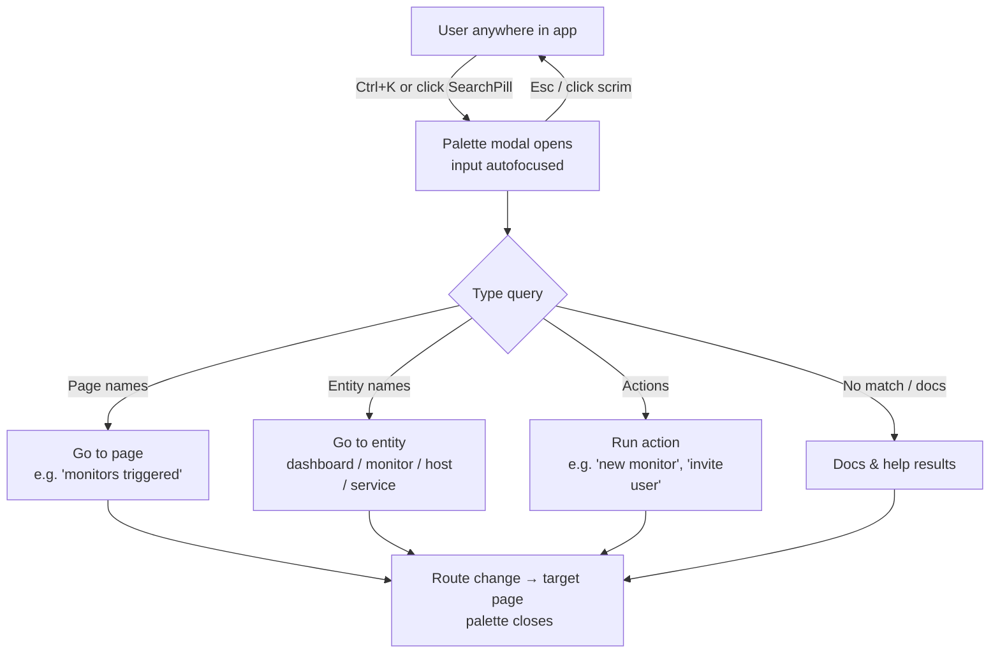
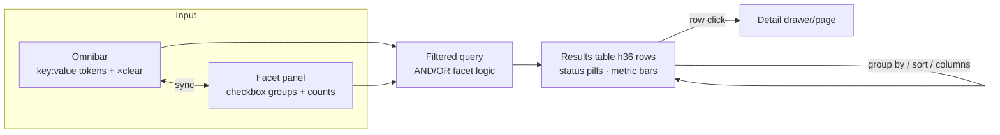
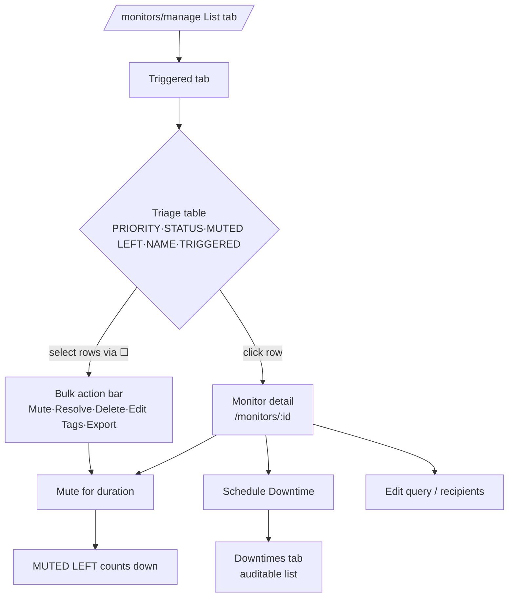
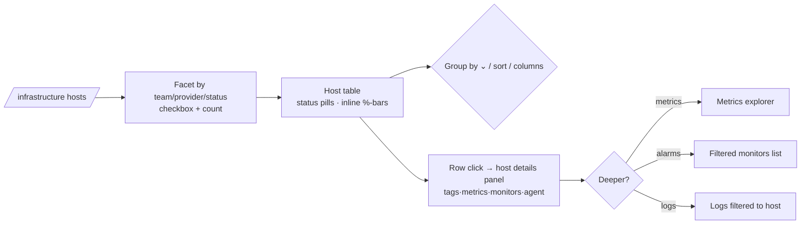
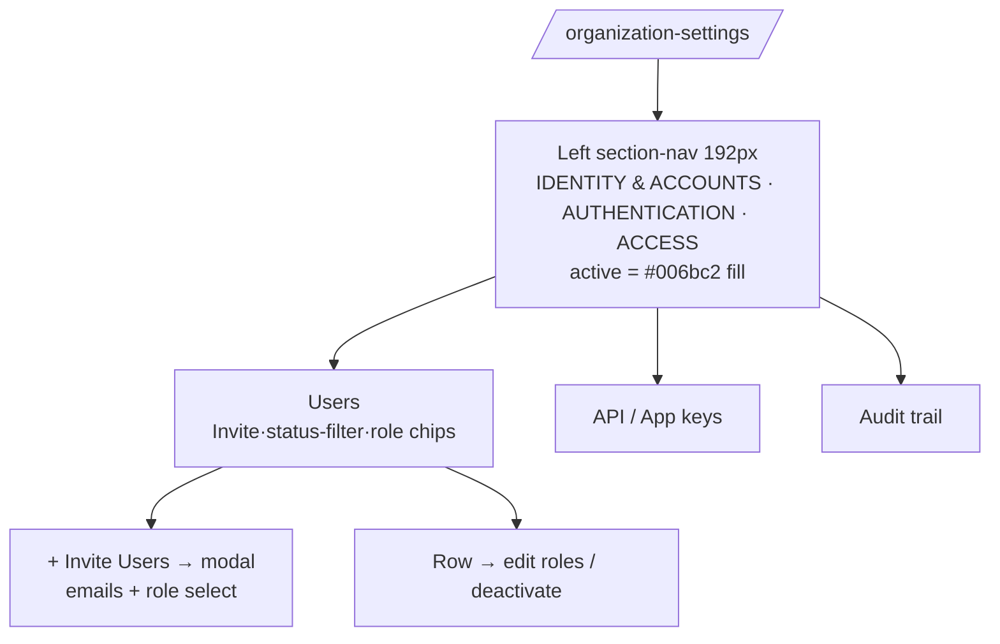

# 03 — UX/UI Research: Datadog (datadoghq.com)

| | |
| --- | --- |
| **Document** | `SDLC/datadog/research/03-ux-ui-research.md` |
| **SDLC phase** | Requirements / Analysis — UX research on a reference product |
| **Subject** | Datadog web application (`ap2.datadoghq.com`), live-captured Oct 2025 |
| **Purpose** | Study how Datadog's interface lets users *find information, check alarms, and issue commands* ("ผู้ใช้ค้นหาข้อมูล ตรวจ Alarm และสั่งงานอย่างไร"), to inform the redesign of our **industrial monitoring dashboard / HMI** |
| **Evidence base** | Live DOM/computed-style captures in `ref/datadog/live/` (r1–r3), distilled spec `ref/datadog/live/COMPONENTS.md` (**authoritative for measured values**), token file `dd-theme.css`, hover-state deltas `r3/states.json` |
| **Status** | Draft for review |

> **Scope note.** This document describes the *external product* Datadog, not our codebase. All pixel values and colors below were measured on the live app via CDP extraction; where a value is quoted it can be traced to `COMPONENTS.md`, `dd-theme.css`, `r3/states.json`, or the per-page `*-layout.json` / `*-components.json` evidence files.

---

## 1. Research question and summary of findings

**Key question (TH):** "ผู้ใช้ค้นหาข้อมูล ตรวจ Alarm และสั่งงานอย่างไร"
**Key question (EN):** How do users find information, check alarms, and issue commands?

Datadog answers this with a **three-layer command model**:

| Question | Datadog's answer | Mechanism |
| --- | --- | --- |
| **Find information** | Two-tier search: a *global* jump-anywhere palette + a *local* structured filter language | `Ctrl+K` command palette in a 600×24 px centered topbar pill → page/entity navigation; per-page omnibar accepting `key:value` facet tokens backed by a left facet panel with checkbox groups and live counts |
| **Check alarms** | A dedicated Monitors section with a state-tabbed triage list | Sub-nav `List \| Triggered \| Downtimes \| Quality \| Analytics`; the **Triggered** tab is a triage queue (PRIORITY / STATUS / MUTED LEFT / NAME / GROUP / TRIGGERED columns); row → monitor detail; status is always text-labeled pills/dots, never color alone |
| **Issue commands** | Selection-driven action bars + role-gated controls | Checkbox column → bottom/contextual **bulk action bar** (`Mute / Resolve / Delete / Edit Tags / Edit Recipients / Edit Teams / Export to Terraform`); row-level and detail-level actions; `+ New Monitor` primary button; admin actions hidden inside `/organization-settings` |

The dominant UX idea: **the list table is the unit of work.** Nearly every task — finding a host, triaging an alarm, administering a user — is modeled as *filter a table → select row(s) → act on selection*. Everything else (palette, facets, detail drawers) is a shortcut into or out of that loop.

---

## 2. Information architecture — the application shell

Datadog uses a **dark chrome + light content** shell. Navigation chrome (rail, topbar) is dark; all work surfaces are white/paper with hairline borders. Measured anatomy (from `COMPONENTS.md` §"Shell anatomy" and the r2 sniper extractions):

```text
┌─ rail ─────────┬─ topbar h36  bg #17191f ───────────────────────────────────┐
│ 160px expanded │  [logo] ······· [🔍 Search Datadog  Ctrl K] ··· [Ask Bits] │
│  → 50px        │      ⌄ centered search pill 600×24, bg white/8             │
│  collapsed     ├─ pagebar h44–45 white, border-b #e2e5ed, sticky z-91 ──────┤
│ bg #292e39     │  Page title · tabs (List | Triggered | Downtimes | …)      │
│ fixed z-100    │                                    right: [+ New Monitor] │
│                ├─ optional second row: omnibar / filter bar ────────────────┤
│ icons+labels   │ ┌ facet panel ─┬─ results table ─────────────────────────┐ │
│ 13px           │ │ sections     │ checkbox col · group headers · rows h36 │ │
│ active #3d8bd0 │ │ checkboxes   │ status pills · inline metric bars       │ │
│ hover #eeefee  │ │ + counts     │                                         │ │
│                │ └──────────────┴─────────────────────────────────────────┘ │
│                ├─ bottom sticky action bar (create/bulk flows) ─────────────┤
│                │  [ghost actions]              [Save as Draft][Publish ▶]  │
│                ├─ footer h55 ───────────────────────────────────────────────┤
└────────────────┴────────────────────────────────────────────────────────────┘
   FlyoutSidebar: 400px white pane, absolute z-101, slides over content from
   rail selections (transform .18s); border-r #e2e5ed, shadow-flyout.
```

### 2.1 Region inventory (measured)

| Region | Measurements | Source |
| --- | --- | --- |
| **AppRail** (left nav) | `fixed`, **160 px** expanded with icon+label items (Bits AI / Dashboards / Monitoring / Developer Portal / Incident Response / Automation…), collapses to **50 px** icon-only via `transform .1s ease-out`; bg `#292e39`; z-100; item h≈28–31 px, 13 px labels `#babdbb` → `#eeefee` on hover, active icon `#3d8bd0` | `COMPONENTS.md` AppRail/NavItem; `r2/*-sniper-raw.json` (`sidebar` rect 0,0 160×945) |
| **TopBar** (global) | h **36 px**, bg `#17191f`, text `white/82`, icons 14–16 px | `COMPONENTS.md` TopBar; states.json |
| **SearchPill** | h **24 px**, w **600 px**, horizontally **centered** in topbar (x≈653 @1920 vw), `bg rgba(255,255,255,.08)` → `.12` on hover, radius 4, 12 px text `white/82`, kbd hint `Ctrl K`, `shadow-dark-btn` | `r2/*-sniper-raw.json` (`searchPill` 653,6 600×24); `COMPONENTS.md` SearchPill |
| **PageBar + tabs** | sticky, h **44–45 px**, white, `border-b #e2e5ed`, z-91; tabs `px-15 text-15`, active `#1c2b34@98%` vs inactive `ink-68` | `COMPONENTS.md` PageBar; `monitors-layout.json` (header 41→85 px band) |
| **FlyoutSidebar** | **400 px** white pane, `border-r #e2e5ed`, `shadow-flyout`, absolute z-101, `transform .18s` | `COMPONENTS.md` FlyoutSidebar; sniper `sidebarItems` 379 px flyout |
| **Facet panel** | Left column inside content (~192–300 px per page); checkbox groups with icons + counts; section collapse carets | `COMPONENTS.md` r2/r3 notes (infra, org-users ~192 px) |
| **Results table** | row h **36 px** (28 px dense), header 11 px `tracking-1.8px` uppercase, hairline `#e2e5ed` row borders, cell text 13 px | `COMPONENTS.md` Table |
| **Bottom action bar** | sticky footer in create/bulk flows; ghost buttons left, `Save as Draft` + primary `Create and publish` right | `COMPONENTS.md` r2/r3 |
| **Footer** | h 55 px legal/version strip | `*-sniper-raw.json` (`footer` 160,890 …×55) |

### 2.2 Navigation model

- **Level 0 — Rail:** product areas (Dashboards, Monitoring, APM, Infrastructure, Logs…). Expandable 160 px ↔ 50 px; labels are optional because icons carry the collapsed state.
- **Level 1 — Flyout:** clicking a rail item can open the 400 px white flyout with section headers (15 px/600) and `h-28` nav rows, instead of navigating immediately. This keeps one-level-deep destinations reachable without losing page context.
- **Level 2 — PageBar tabs:** within a product area, horizontal tabs (`List | Triggered | Downtimes | Quality | Analytics`) — **tabs are views of the same dataset, not separate apps**.
- **Level 3 — In-content left nav:** used inside wide sections (Organization Settings, monitors create) where tabs alone are insufficient; ~192 px, uppercase 10 px section headers, **active row = solid `#006bc2` fill with white text** (not a tint).
- **Escape hatch — Ctrl+K palette:** skips the whole tree; see §3.1.

---

## 3. User flows

Each flow below gives: goal → entry points → step-by-step path → diagram → the measured UI mechanics that make it work → takeaway for our HMI.

### 3.1 Global find — command palette (`Ctrl+K`)

**Goal:** jump to any page, dashboard, monitor, host, or doc without knowing where it lives.

**Mechanics:** the topbar pill is a *button*, not an input — `Search Datadog  ⌃K`, 600×24 px, centered, `bg white/8` (`→ white/12` hover). Click or `Ctrl+K` opens a modal palette: text field, grouped results (pages / entities / actions / docs), `↑↓` to move, `↵` to go, `Esc` to close. An `Ask Bits` (AI) affordance sits adjacent — search and assistant share the topbar.



```text
 any page
   │  Ctrl+K
   ▼
┌──────────────── palette ────────────────┐
│ 🔍 ▍                                    │
│ ─────────────────────────────────────── │
│ PAGES      Monitors · Dashboards · …    │
│ ACTIONS    New Monitor · Invite Users   │
│ ENTITIES   host:i-0abc… · svc:web-api   │
└─────────────────────────────────────────┘
   │ ↵                    │ Esc
   ▼                      ▼
 destination            (unchanged page)
```

**Why it matters for HMI:** operators under pressure cannot browse a nav tree. A palette gives *one keystroke* to any screen/alarm tag/faceplate command — our equivalent is "jump to loop/equipment/alarm by tag."

### 3.2 Search & filter — omnibar → facet panel → results table

**Goal:** reduce a large fleet/dataset to the relevant subset without writing a query language.

**Mechanics:** a per-page **omnibar** sits under the pagebar. Typing offers facet autocompletion; confirmed facets become **`key:value` token chips** inside the bar (removable via `×`, plus a clear-all). In parallel, a **left facet panel** lists the same facets as collapsible checkbox groups, each row = icon + label + **result count**. Checking a box injects the equivalent token into the omnibar — the two representations stay in sync, so novices can click while power users type. Results render in the dense table (row h36, 13 px). Right-side controls: `Group by` dropdown, time-range stepper (`15m … ◀ ▶`), `Export`, `Columns ⌄`.



```text
┌ omnibar ────────────────────────────────────────────┐
│ [provider:aws ×] [team:backend ×] status:alert ▍  ✕ │   [Group by ⌄] [15m ◀▶] [Export][Columns ⌄]
└──────────────────────────────────────────────────────┘
┌ facets ────┐ ┌ table ───────────────────────────────┐
│ MY TEAMS ⌄ │ │ ☐ NAME          STATUS      CPU       │
│ ☑ backend 4│ │ ☑ web-01    [● ALERT]    87% ▓▓▓▓░░   │
│ ☐ data    2│ │ ☐ web-02    [● OK]       12% ▓░░░░░   │
│ PROVIDER ⌄ │ │ ☐ db-01     [● NO DATA]   —           │
│ ☑ aws 6    │ └──────────────────────────────────────┘
│ ☐ gcp 0    │
└────────────┘
```

**Measured values:** omnibar input h32, `border #c2c8dd` 1 px, `pl-6` icon space, 13 px; facet counts in `ink-46`; table header 11 px / tracking 1.8 px (`COMPONENTS.md` Table, Input; `infra-*` vocab: `13px`×1267 dominant size).

### 3.3 Alarm triage — monitors/manage → state tabs → row → detail → ack/mute/downtime

**Goal:** answer "what is firing right now, who is handling it, and how do I silence it safely."

**Mechanics:** `/monitors` sub-nav = `List | Triggered | Downtimes | Quality | Analytics` + right-aligned `Settings`, `Browse Templates`, primary `+ New Monitor` (124×28 px).

- **Triggered tab = the triage queue.** Columns: `PRIORITY | STATUS | MUTED LEFT | NAME | GROUP | TRIGGERED`. Each row's STATUS is an **uppercase 11 px/600 pill** (h20, `rounded-full`, neutral `#828ba4` for non-firing, severity colors for firing) — text *and* color, never color alone.
- **Selection → bulk bar.** A leading checkbox column; checking rows reveals the bulk action bar: `Mute | Resolve | Delete | Edit Tags | Edit Recipients | Edit Teams | Export to Terraform` (r2 captured text). `Mute` accepts a duration → the `MUTED LEFT` column counts it down — **a timed silence is a first-class column**, not hidden state.
- **Group headers** group rows by monitor pack (`bg #f9fafb`, caret + name) so a triage list stays scannable.
- **Row → monitor detail** (`/monitors/:id`): status header, query/graph, evaluation history, and the same verbs (Mute / scheduled **Downtime** / edit / delete) plus notification recipients.
- **Downtimes tab** = scheduled silences managed as data (a list you can audit), not a per-alarm side-effect.
- **Empty state still teaches:** "No monitors are triggered right now" inside the full table frame + recommended-template cards (`COMPONENTS.md` r2/r3 notes).



```text
List | Triggered* | Downtimes | Quality | Analytics        Settings  Browse Templates  [+ New Monitor]
────────────────────────────────────────────────────────────────────────────────────────────────
☐ │ PRIORITY │ STATUS   │ MUTED LEFT │ NAME                          │ GROUP │ TRIGGERED
☑ │ P2       │ ▓ ALERT  │ 12m        │ CPU high on {{host.name}}     │ host  │ 4m ago
────────────────────────────────────────────────────────────────────────────────────────────────
[☑ 1 selected]   ( Mute )  ( Resolve )  ( Delete )  ( Edit Tags )  ( Edit Recipients )  ( Export )
```

**Why it matters for HMI:** this is the closest analog to an alarm console — a state-tabbed queue, timed shelving (Mute/Downtime ≈ alarm shelving), bulk acknowledge, and an auditable silence list. The `MUTED LEFT` countdown column is a pattern worth copying verbatim for shelved-alarm visibility.

### 3.4 Create monitor — numbered steps → right sticky preview → publish

**Goal:** author a detection rule without losing sight of what it will do.

**Mechanics** (`/monitors/create`, `COMPONENTS.md` r2/r3 + `moncreate-sniper-raw.json`):

1. **Detection-method card grid** — 2-column card chooser (Metric / APM / Logs / RUM / Synthetics…); selected card gets `border-blue` + `shadow-card`.
2. **Numbered wizard sections** — each step headed by a **20 px purple circle `#632ca6` + 15 px/600 title + caret**: choose detection → define the query → set alert conditions (thresholds, evaluation window) → say what's wrong (message + template vars `{{host.name}}`) → notify (recipients/channels).
3. **Right sticky preview column** (~288 px, `position: sticky` under the chrome): live preview of the monitor — graph + current evaluated value — updating as the query edits. The layout literally reserves a ~400 px right gutter (`monitor-create-layout.json`: body `pad: 0 400px 0 0`, content 1505 px of 1905).
4. **Bottom sticky action bar** — ghost buttons left (`Test notifications`, discard), `Save as Draft` + primary `Create and publish` right.
5. `Source | Edit` tabs let experts bypass the form and write the monitor as JSON (captured tabs at y=707 in sniper).

```mermaid
flowchart TD
    N[/monitors/create/] --> S1[① Pick detection method\n2-col card grid, selected=border-blue]
    S1 --> S2[② Define query\nmetric/query editor + tokens]
    S2 --> S3[③ Set alert conditions\nthresholds · eval window · no-data]
    S3 --> S4[④ Say what's happening\nmessage template {{vars}}]
    S4 --> S5[⑤ Notify your team\nrecipients · renotify]
    S1 & S2 & S3 & S4 & S5 -.live.-> P[[Sticky preview 288px\ngraph + would-fire state]]
    S5 --> B{Bottom sticky bar}
    B -->|Save as Draft| D[Draft monitor]
    B -->|Create and publish| M[Live monitor → /monitors/manage]
```

```text
┌ 1 Select detection        ┌────────── preview (sticky, 288px) ──────────┐
│ ┌───────┐ ┌───────┐      │ Metric Monitor                               │
│ │Metric*│ │ APM   │      │  ┌ graph ┐   alert if > 90% for 5m           │
│ └───────┘ └───────┘      │  └───────┘   now: ● OK (would not fire)      │
│ 2 Define the query       │                                             │
│   avg:cpu{host:*}        └─────────────────────────────────────────────┘
│ 3 Set conditions…        ┌ sticky bottom bar ──────────────────────────┐
│                          │ [Test] [Discard]      [Save as Draft][Publish]│
└──────────────────────────└─────────────────────────────────────────────┘
```

**Why it matters for HMI:** alarm-rule authoring is exactly this shape — pick a tag/limit type, define expression, set thresholds, preview *what would have fired*. The sticky preview + draft/publish split maps directly to "test the rule against live/historical data before it pages the control room."

### 3.5 Investigate a host — infra host list → facets → row → details panel

**Goal:** go from "something is wrong in the fleet" to a specific host's health.

**Mechanics** (`/infrastructure`, r3 `infra-hosts.png` + `COMPONENTS.md` r2/r3):

- Omnibar with facet tokens + `×` clear; `Group by` dropdown right.
- Left facet panel: `My Teams ⌄` + provider checkboxes (icons + counts) — filter by ownership first, infra second.
- Table cells carry **status-count pills** (`8 OK` / `1 ALERT` / `4 LOGS`) and **inline %-bar metric cells** — the number *and* a blue mini-bar under it, so columns double as sparkline-less overviews.
- Right controls: `Default | Metrics` segmented toggle, `Export`, `Columns ⌄`; **time-range stepper** top-right.
- Row click → host details panel (side drawer): tags, metrics, monitors on that host, agent status — investigation without losing list position.



**Why it matters for HMI:** asset investigation = equipment drill-down. The pattern *fleet table → contextual details drawer → jump to pre-filtered views* is the HMI equivalent of *unit overview → equipment faceplate → its alarms/trends*.

### 3.6 Admin — organization settings left section-nav → users/keys/audit

**Goal:** manage org-level objects (users, roles, API keys, audit) — low-frequency, high-risk actions, so they are deliberately *deep* in the IA, behind role gates.

**Mechanics** (`/organization-settings/*`, r2 `settings.png`, `settings-sniper-raw.json`, `COMPONENTS.md` r2/r3):

- **In-content left nav ~192 px**: uppercase **10 px** section headers (`IDENTITY & ACCOUNTS` / `AUTHENTICATION` / `ACCESS`), nav rows h-32/h-8, 13 px; **active row = solid `#006bc2` fill + white text** — a filled pill, unmistakably "you are here."
- **Users page**: title + primary `+ Invite Users` (117×28); status filter checkboxes with **colored dots** (green=Active, yellow=Invite Pending, gray=Deactivated); `List View ⌄` display switch; user cards/rows with squircle avatar (40×40 `rounded-[25%]`), role chips (`Datadog Admin Role` chips h18); pagination `Showing 1–1 of 1 User`.
- Section pages for API keys / application keys / audit trail follow the same left-nav + title + primary-action + filter + list template.



**Why it matters for HMI:** admin verbs (manage users, keys, audit log) must be reachable but never adjacent to operational verbs. Datadog's "deep section + filled active nav + explicit primary button" pattern plus role-gated visibility is the model for our admin area.

---

## 4. Annotated screenshot inventory

All captures live under `ref/datadog/live/` (relative paths below are from `SDLC/datadog/research/`). Naming convention: `dd-*`/`page.png`/`moncreate.png`/`settings.png`/`notif.png`/`apm.png`/`infra-hosts.png` = **live Datadog**; `app-*.png` = **our reimplementation** captured for visual diffing; `diff-*.png` = **overlay diff** between the two.

### 4.1 Capture tree

```text
ref/datadog/live/
├── COMPONENTS.md                 ← authoritative measured spec (cited throughout)
├── dd-theme.css                  ← extracted Tailwind v4 @theme tokens
├── pages.txt / pages-all.txt     ← route inventory (23 crawled routes)
├── *-{components,layout,vocab,text,icons}.json   ← per-page computed-style evidence
├── r1/  pass 1 @1440px           dd-1440.png · app-1440.png · components.json · layout.json
├── r2/  pass 2 @1920px
│   ├── monitors/page.png + app.png + sniper.json     (monitors/manage list)
│   ├── moncreate.png + moncreate-sniper-raw.json     (monitor create /new layout)
│   ├── settings.png + settings-sniper-raw.json       (organization-settings/users)
│   ├── notif.png + notif-sniper-raw.json             (monitors/triggered queue)
│   ├── apm.png + apm-sniper-raw.json                 (APM services list)
│   ├── app-palette.png · app-admin-users.png · app-rule-create.png · app-line.png
│   └── {dashboards,events,infra,logs,metrics,notebook,org,watchdog}/page.png + dd-*.json
└── r3/  pass 3 @1920px
    ├── dd-monitors-1920.png      (live monitors/manage @1920)
    ├── app-alarms-1920.png       (our alarms page @1920)
    ├── diff-1920.png             (visual diff of the two)
    ├── infra-hosts.png           (live infrastructure host list)
    ├── apm-services.png          (live APM services)
    └── states.json               (real-mouse hover deltas via CDP)
```

### 4.2 Annotation blocks

#### `r2/monitors/page.png` + `r3/dd-monitors-1920.png` — Monitor list (the alarm-console home)


- **Pattern demonstrated:** state-tabbed data table as the unit of work — `List | Triggered | Downtimes | Quality | Analytics` in a sticky 44–45 px pagebar; `+ New Monitor` primary (h28) top-right beside `Settings` / `Browse Templates`.
- **Key measured values:** pagebar h44–45 `border-b #e2e5ed` z-91; table row h36, header 11 px `tracking-1.8px`; group header rows `bg #f9fafb`; checkbox column + bulk bar `Mute | Resolve | Delete | Edit Tags | Edit Recipients | Edit Teams | Export to Terraform` (`COMPONENTS.md` r2/r3 + `monitors/dd-text.json`).
- **Interaction supported:** alarm inventory browsing → select → bulk command; entry into triage (Triggered) and scheduled silences (Downtimes).
- **Also note:** `LIVE MONITORING` info banner + "recommended templates" cards — the empty list still teaches.

#### `r2/notif.png` — Triggered monitors (the triage queue)


- **Pattern demonstrated:** dedicated "what is firing *now*" view; columns `PRIORITY | STATUS | MUTED LEFT | NAME | GROUP | TRIGGERED`; `Show Controls` toggles the filter rail; empty queue renders the full table frame with "No monitors are triggered right now" (`notif-sniper-raw.json`).
- **Key measured values:** tab h45 `px-15 text-15`; active tab `text-ink`; status = uppercase 11 px/600 pill h20 `rounded-full`; `+ New Monitor` 124×28 px primary.
- **Interaction supported:** the check-alarms loop — scan severities, spot muted-but-counting-down items, bulk Mute/Resolve, click through to detail.

#### `r2/moncreate.png` — Monitor create


- **Pattern demonstrated:** numbered-step create wizard with **right sticky preview (~288 px)** and **bottom sticky action bar** — the "configure on the left, trust on the right" layout.
- **Key measured values:** step number = 20 px purple circle `#632ca6` + 15 px/600 titles; detection cards 2-col, selected `border-blue` + `shadow-card`; ~400 px right gutter (`pad: 0 400px 0 0` on body, content 1505/1905 px); `Save as Draft` + `Create and publish`; `Source | Edit` tabs h36 (`COMPONENTS.md` r2/r3; `monitor-create-layout.json`; `moncreate-sniper-raw.json`).
- **Interaction supported:** safe alarm-rule authoring — preview the would-fire state before publishing.

#### `r2/settings.png` + `r2/app-admin-users.png` — Organization settings / Users


- **Pattern demonstrated:** in-content admin nav — ~192 px left rail with **10 px uppercase section headers** (IDENTITY & ACCOUNTS / AUTHENTICATION / ACCESS) and **active = solid `#006bc2` fill**; content = title + primary `+ Invite Users` + status-filter checkboxes w/ colored dots + `List View ⌄` + role-chipped user rows.
- **Key measured values:** nav rows h-8 13 px; `Invite Users` 117×28; chips h18 (`Datadog Admin Role`); pagination 18 px text (`settings-sniper-raw.json`; `COMPONENTS.md` r2/r3).
- **Interaction supported:** role-gated admin verbs — invite, role assignment, deactivation — quarantined from operational screens.
- **Companion shot:** `app-admin-users.png` is our port of the same layout for side-by-side verification.

#### `r3/infra-hosts.png` — Infrastructure host list


- **Pattern demonstrated:** full facet-filter architecture — omnibar tokens + `My Teams`/provider checkbox facets with counts → table whose cells embed **status-count pills** (`8 OK`/`1 ALERT`) and **inline %-bar metrics**; `Default | Metrics` segmented + `Export` + `Columns ⌄` + time-range stepper.
- **Key measured values:** input h32 `border #c2c8dd`; 13 px dominant text (infra vocab: `13px`×1267 occurrences); row h36; facet counts `ink-46` (`COMPONENTS.md` r2/r3; `infra-vocab.json`).
- **Interaction supported:** fleet→asset drill-down (flow §3.5).

#### `r3/apm-services.png` + `r2/apm.png` — APM services list


- **Pattern demonstrated:** same omnibar+facet+table grammar applied to services — proof the pattern is *domain-independent* (hosts, monitors, services, users all share it).
- **Interaction supported:** cross-domain consistency — learn once, filter anywhere.

#### `r2/app-palette.png` — Command palette (our port)

- **Pattern demonstrated:** the `Ctrl+K` palette UI — centered modal, grouped results, kbd hints. Live evidence for the entry point: `searchPill` 600×24 centered, `bg white/8→12`, text "Search Datadog ⌃K" (`*-sniper-raw.json`, `states.json` `ghost-btn`).

#### `r3/diff-1920.png` + `r3/app-alarms-1920.png` — port fidelity diff

- **Pattern demonstrated:** pixel-level comparison of live `dd-monitors-1920.png` vs our `app-alarms-1920.png`; used to verify the ported alarm list preserves density (row h36), pagebar geometry, and bulk-bar placement. Review this file when auditing what was *copied faithfully vs adapted* (e.g. we ported only **Ack** of the bulk verbs — the only one our API supports).

#### `r1/dd-1440.png` + `r1/app-1440.png` — responsive check @1440 px

- **Pattern demonstrated:** the shell at a narrower viewport — rail collapsed behavior, topbar pill shrinking, table column compression. Useful for our minimum-operator-station resolution target.

#### `r3/states.json` — measured hover deltas (not a screenshot, interaction evidence)

| Element | Rest → Hover (measured via real CDP mouse) |
| --- | --- |
| Topbar icon/action | transparent → **`#006bc2` fill** |
| Search pill | `rgba(255,255,255,.08)` → `.12` |
| Dark-chrome button (Get Started) | text `.76`→`1` white, border `#65626a`→`#858387`, gains shadow `0 0 1px rgb(36 41 49/.1), 0 1px 2px rgb(9 9 11/.88)` |
| Tab | `ink-68` → **`#0b0f8b` dark indigo** |
| Link/clickable row | `#f9fafb` → `#eaf6fc` (info-soft tint) |
| Text input `:focus` | **no visual change measured** — DD's focus is subtle/absent; we keep a blue outline anyway for a11y |

---

## 5. Design system summary (measured, cited)

All values from `COMPONENTS.md` + `dd-theme.css` unless noted.

### 5.1 Typography — dense, 13 px-dominant

| Role | Size/weight | Token |
| --- | --- | --- |
| Dominant body/table/nav/buttons | **13 px** | `--text-md` (e.g. `13px`×1267 occurrences on infra page) |
| Tabs, section titles | 15 px (600 for heads) | `--text-lg` |
| Page titles | 16 px | `--text-xl` |
| Pills / table headers / overline | **11 px, 600, uppercase, tracking 1.8 px** | `--text-xs` |
| Dark-chrome controls, kbd hints | 12 px | `--text-sm` |
| Rare badges / admin section heads | 10 px uppercase | `--text-2xs` |
| Leading | often = font-size (`leading-flush: 1`) — extreme density | `--leading-flush` |
| Families | `NotoSans / IBM Plex Sans` stack; mono = `Roboto Mono / IBM Plex Mono` | `--font-sans`/`--font-mono` |

### 5.2 Color

| Role | Value | Token |
| --- | --- | --- |
| Dark chrome rail | **`#292e39`** | `--color-rail` |
| Topbar | `#17191f` | `--color-topbar` |
| Primary action / links / active admin nav | **`#006bc2`** | `--color-blue` |
| Active rail item | `#3d8bd0` | `--color-blue-nav` |
| Ink text | `rgb(28 43 52 / .98)` / `.68` / `.46` / `.35` | `--color-ink*` |
| Paper / subtle bg | `#fff` / **`#f9fafb`** | `--color-paper`/`--color-subtle` |
| Hairline border | **`#e2e5ed`** | `--color-line` |
| Input border | `#c2c8dd` | `--color-line-hard` |
| Step-number purple | `#632ca6` | `--color-purple-dd` |
| Warn | `#f99d02`; info tint `#eaf6fc`; warn tint `#fcd579` | `--color-warn`/`--color-info-soft`/`--color-warn-soft` |
| Neutral status pill | `#828ba4` | `--color-muted-pill` |

### 5.3 Shape, depth, density

| Thing | Value |
| --- | --- |
| Radius | **4 px everywhere**; 5 px cards; 8 px panels/flyouts; `rounded-full` pills; 25% squircle avatars |
| Shadows | card `0 0 1px rgb(36 41 49/.1), 0 1px 2px /.25`; pop `…0 3px 11px /.25`; flyout `…0 8px 36px /.25`; dark-btn `0 .25px 2px rgb(0 0 0/.6) + inset white .5px` |
| Heights | control **28 px**; small dark control 24 px; input 32 px; row 36 px; topbar 36 px; pagebar 44 px; nav item 28 px |
| Spacing | content padding 16 px, indents 24 px |
| Icons | 12 / 14 / 16 px only, `currentColor` |
| Motion | rail `transform .1s ease-out`; flyout `.18s`; card hover `box-shadow .25s` |

### 5.4 Status with non-color redundancy

Status is **always encoded twice**: uppercase text pill (`OK`, `ALERT`, `NO DATA`, `MUTED`) *plus* color; status *dot* `h-2 w-2 rounded-full` accompanies labels in filters; `MUTED LEFT` is a numeric countdown column. A colorblind operator loses zero information — a hard requirement we inherit for an HMI (per ISA-101-style guidance: state, not just hue).

---

## 6. Interaction patterns worth copying into our industrial HMI

Ranked by value-to-effort for an industrial monitoring redesign:

| # | Datadog pattern | What it is | HMI adaptation |
| --- | --- | --- | --- |
| 1 | **Facet filtering** (omnibar tokens ⇄ checkbox panel + counts) | Two synchronized representations of one filter model — click for novices, `key:value` for experts; counts preview result-set size | Alarm/equipment filtering by area, unit, priority, state, tag — counts warn an operator "this filter still shows 300 alarms" before they commit |
| 2 | **Bulk-select action bar** | Checkbox column → contextual bar of verbs (`Mute/Resolve/…`) scoped to selection | Bulk **ack/shelve/tag** on the alarm console; must remain disabled behind role check; keep a `MUTED LEFT`-style countdown column for shelved alarms |
| 3 | **Sticky preview in create flows** | ~288 px live preview column + bottom sticky `Save as Draft / Publish` bar | Alarm-limit / interlock-rule editor: show would-trip evaluation on live data before publish; draft vs. publish maps to engineering vs. operational states |
| 4 | **Keyboard command palette** | `Ctrl+K` centered pill → jump to any page/entity/action | "Jump to tag/loop/alarm ID" palette — fastest known path under upset conditions; also surfaces commands (ack all in area, open faceplate) |
| 5 | **Role-gated actions** | Admin verbs quarantined in `/organization-settings` behind a filled-nav section; destructive verbs only in selection context | Operator vs. engineer vs. admin verb visibility; never put user/key management beside plant controls |
| 6 | **State tabs on one dataset** | `List \| Triggered \| Downtimes \| Quality \| Analytics` = filtered views, not separate apps | Alarm console views: All \| Active \| Shelved \| Suppressed-by-design \| Quality (chattering analysis!) — Datadog's *Quality* tab is our alarm-flooding/bad-actor report |
| 7 | **Non-color status redundancy** | Text pill + dot + countdown, never hue alone | Mandatory in HMI; extend with shape/label per ISA-101 |
| 8 | **Empty state that teaches** | "No monitors triggered" + recommended templates inside the table frame | Clean-slate consoles still show the frame + next action ("no active alarms — last cleared 14:32") |
| 9 | **Density discipline** | 13 px base, h28 controls, h36 rows, 4 px radii, hairlines — ~2× the info density of consumer SaaS | Operator consoles need this density; adopt the measured table wholesale (h36 rows, 11 px tracked headers) |
| 10 | **In-content filled left nav** | ~192 px section nav, active = solid `#006bc2` fill | Deep areas (engineering config) get unmistakable location feedback |

**Deliberately *not* copying:** Datadog's near-invisible `:focus` rings (a11y risk — keep our visible outline), purple brand accents on operational surfaces (use restrained industrial palette), and the trial/marketing banners in chrome.

---

## 7. Coverage gaps and follow-ups

Known holes in the capture set (from `COMPONENTS.md` §gaps + inventory):

- **Dashboard widget canvas** (graph internals) not captured — relevant if our redesign includes trending widgets.
- **Monitor detail drawer internals** partially captured (route `/monitors/1190551` vocab exists; drawer mechanics not measured).
- **`?` keyboard-shortcut overlay** exists in DD but wasn't captured — worth a pass before speccing our palette's shortcut sheet.
- **`:active`/focus-visible ring values** absent — we keep our own a11y rings.
- If needed, recapture: logs explorer (largest facet vocabulary), dashboards widget edit, incident response flow.

## Appendix — evidence files

| File | Contents |
| --- | --- |
| `ref/datadog/live/COMPONENTS.md` | Authoritative measured spec (shell anatomy, component recipes, r2/r3 patterns, hover deltas) |
| `ref/datadog/live/dd-theme.css` | Extracted design tokens (Tailwind v4 `@theme`) |
| `ref/datadog/live/pages-all.txt` | 23 crawled routes (monitors, triggered, downtimes, quality, create, detail, infra, apm, org, …) |
| `ref/datadog/live/*-vocab.json` | Per-page frequency-ranked computed values (e.g. 13 px dominance) |
| `ref/datadog/live/*-layout.json` | Per-page geometry trees (rail rect, sticky headers, 400 px preview gutter) |
| `ref/datadog/live/r2/*-sniper-raw.json` | Structured section extraction: sidebar/topbar/searchPill/tabs/table/buttons rects + text |
| `ref/datadog/live/r3/states.json` | Real-mouse hover deltas (§4.2) |
| `ref/datadog/live/r{1,2,3}/*.png` | Screenshots annotated in §4 |
