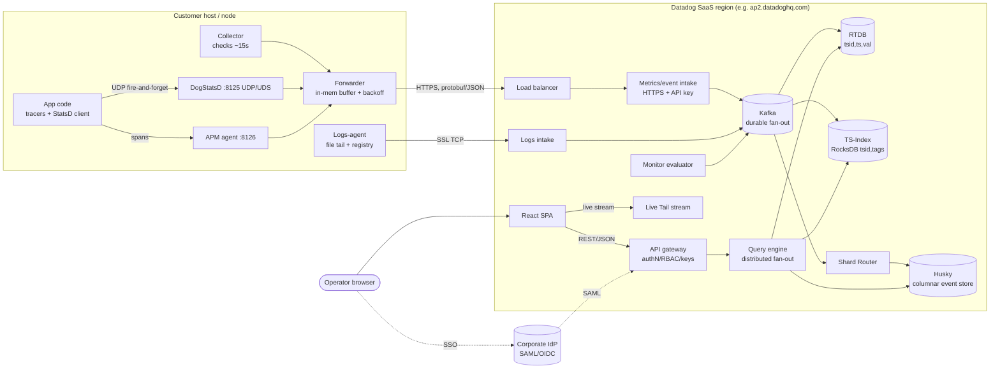
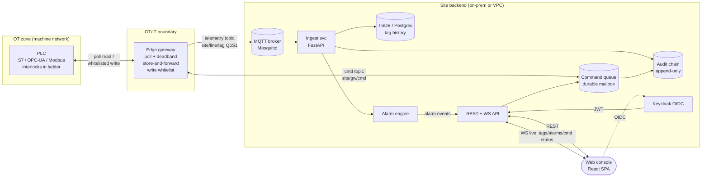

# SDLC Technical Research — Datadog Architecture & Industrial Equivalent

| | |
| --- | --- |
| Document | `05-technical-research.md` |
| Phase | Research / Requirements analysis |
| Subject | Datadog reference architecture (public knowledge) → industrial monitoring stack redesign |
| Audience | Backend + frontend engineers redesigning the Plant Ops OS monitoring stack (PLC → edge gateway → backend → web console) |
| Status | Draft for review |
| Local evidence | `ref/datadog/live/COMPONENTS.md` (measured UI), `ref/datadog/live/pages.txt`, `web.bak/` (prior FastAPI + edge-bridge implementation), `infra/` (Keycloak, Mosquitto, Postgres) |

---

## 0. Research question

> **"เว็บเชื่อม PLC, Gateway และ Backend อย่างไร"**
> ("How does the web [console] connect to the PLC, the gateway, and the backend?")

The question is answered **twice**:

- **(a) Datadog's version** — how a Datadog Agent on a host connects to Datadog's
  intake APIs, how telemetry flows through the multi-tenant SaaS backend, and how the
  browser webapp reads it back (§1–§2).
- **(b) The industrial equivalent** — how a SCADA-lite web console connects to a PLC
  through an edge gateway and a site backend, including the **control (write) path**
  that Datadog does not have (§3–§4).

The structural mapping that drives the whole document:

| Layer | Datadog | Industrial SCADA-lite |
| --- | --- | --- |
| Data source | Host / container / app | PLC (Siemens S7, OPC-UA server, Modbus TCP/RTU) |
| Edge collector | Datadog Agent + DogStatsD | Edge gateway (tag poller, store-and-forward) |
| Transport | HTTPS intake API (+ TCP for logs) | MQTT or HTTPS northbound |
| Backend | Multi-tenant SaaS: intake → Kafka → stores → query | Ingest API → broker → TSDB + alarm engine + command queue |
| Web app | React SPA + REST/WebSocket per region site | React SPA + REST/WS on site network |
| Control direction | Read-only telemetry (no write-back to hosts) | **Bidirectional**: operator commands → PLC writes |

The last row is the single most important divergence. Datadog is a *telemetry*
system; a plant console is a *telemetry + control* system. Everything in §4–§6
follows from that difference.

---

## 1. Datadog reference architecture (public knowledge)

Sources: Datadog public documentation (`docs.datadoghq.com/agent`, `agent/guide/agent-retry`,
`account_management/*`), Datadog engineering blog posts ("Timeseries indexing at scale",
"Rust timeseries engine", "Introducing Husky", "Husky deep dive"), and the open-source
`DataDog/datadog-agent` repository. All of this is published material; nothing below
is reverse-engineered.

### 1.1 Component inventory

#### Datadog Agent (the "edge" tier)

One Agent per host/VM/container node. Agent v6/v7 is a Go binary embedding a Python
runtime for checks, composed of:

| Sub-process | Role |
| --- | --- |
| **Collector** | Runs scheduled checks (system metrics every ~15 s; integration checks for nginx, Postgres, etc.; Autodiscovery for containers) |
| **DogStatsD server** | StatsD-compatible aggregation daemon, UDP/UDS port 8125; apps push custom metrics fire-and-forget; DogStatsD rolls them up locally |
| **Forwarder** | Queues payloads and sends them over **HTTPS** to intake endpoints; in-memory retry buffer with exponential backoff + jitter; oldest metrics dropped when the buffer cap is hit (bounded loss by design) |
| **APM/trace-agent** (optional) | Receives traces from language tracers (port 8126), normalizes/samples, forwards |
| **Process-agent** (optional) | Live process/container inventory |
| **Logs-agent** (optional) | Tails files/journald/containers; sends over SSL TCP; **disk-backed registry** of read offsets flushed every 1 s — stronger delivery guarantee than metrics |
| **system-probe** (optional) | eBPF: NPM, USM, CWS runtime security |

Agent control/observability ports (5000 status, 5001 CLI/GUI IPC, 5002 GUI on
Win/macOS) bind to localhost only. Remote Config lets the fleet receive config/APM
sampling/rule updates from the backend — Datadog's own "control path," but scoped to
agent configuration, never to the monitored workload.

#### Integrations

900+ built-in checks; custom checks in Python; OpenTelemetry/DDOT collector path;
cloud-provider crawlers (AWS/Azure/GCP) that pull telemetry agentlessly.

#### Intake tier

- Public HTTPS endpoints per **site/region**: `*.datadoghq.com` (US1), `us3/us5`,
  `ap1/ap2.datadoghq.com`, `datadoghq.eu`, `ddog-gov.com` (FedRAMP), `uk1`.
- Auth on ingest: org-scoped **API key** (`DD-API-KEY` header). Payloads are
  protobuf (V2 API) or JSON (V1); compressed, batched by the serializer.
- Logs and Live Tail use a separate hostname (`live.logs.datadoghq.com`) — a
  streaming path distinct from batch intake.

#### SaaS backend (multi-tenant)

Published shape of the metrics pipeline ("Timeseries indexing at scale",
"Rust timeseries engine" posts):

1. **Intake service** — stateless receivers behind load balancers; validates API
   key, resolves tenant, decompresses, enriches (tags, origin detection).
2. **Kafka** — durable message broker; the fan-out point that lets independent
   services consume the same stream (real-time storage, indexing, archival to
   object storage, monitors).
3. **Real-time metrics storage** — two separately deployed services:
   - **RTDB** (Rust): stores `<timeseries_id, timestamp, float64>` tuples,
     in-memory-optimized with snapshots for durability; sharded by a **storage
     router** that distributes series by load.
   - **Timeseries Index** (RocksDB-based): stores `<timeseries_id, tags>`; tag
     indexing exists so queries filter/group by tags without scanning raw points.
4. **Long-term storage** — columnar archival in object storage.
5. **Logs/events** — **Husky**, a custom distributed columnar event store with
   compute/storage separation; a **Shard Router** maps events→Kafka partition
   groups ("shards") deterministically by `(event id, timestamp)` for exactly-once
   ingestion and tenant-aware data locality; replicated storage nodes per shard.
6. **Query layer** — distributed query engine; fans out to index nodes + RTDB
   nodes, merges partial aggregates; served behind an **API gateway** that handles
   authN/authZ, rate limits, app-key scopes.
7. **Alerting** — monitor evaluator consumes the same streams; notifications via
   webhooks/email/PagerDuty etc.

#### Web application tier

- **React SPA** served per region (`app.datadoghq.com`, `ap2.datadoghq.com`, …);
  heavy client-side state, `tag:value` query language everywhere, right-side
  detail drawers, notebooks/dashboards/monitor editors.
- **REST/GraphQL-ish API gateway** calls for queries and CRUD (dashboards,
  monitors, org settings).
- **Live streaming**: Live Tail streams unsampled post-pipeline logs for a 15-min
  window (server-side sampling only for readability under extreme rate); live
  dashboards use short-interval polling/streaming — functionally a "live push"
  channel over HTTP/WebSocket-class transports.
- **Auth**: SAML SSO, OIDC, Google OAuth; SAML attribute→role mapping; **RBAC**
  (default roles Admin/Standard/Read-only + custom roles with granular
  permissions like `logs_live_tail`, `monitors_write`, `audit_logs_read`);
  **API keys** (org ingest) vs **application keys** (per-user/service API access,
  scopable, OTR mode); **Audit Trail** product records org-level admin/mutation
  events; service accounts; optional SAML strict mode, 2FA, IP allow-listing.

### 1.2 Datadog component diagram



ASCII fallback (identical topology):

```text
+----------- HOST -----------+        +--------- DATADOG SAAS REGION ---------+
| app --UDP--> DogStatsD \   |        |                                       |
| app -------:8126-> APM  >--| HTTPS  | intake --> Kafka --> RTDB (ts,vals)   |
| Collector -------------/   | +apikey|          |   |--> TS-Index (tags)     |
| Logs-agent --SSL/TCP-------|------->|          |   '--> ShardRouter-> Husky |
+----------------------------+        |          v                           |
                                      |   query engine <-- API gateway <-- SPA (browser)
                                      |          ^              ^   SAML/OIDC |
                                      |     monitor eval   IdP -+             |
                                      +----------------------------------------+
```

### 1.3 Answer (a): how Datadog connects agent → intake → backend → webapp

Condensed end-to-end trace of one metric point and one user click:

1. **Emit.** App calls `statsd.gauge("line.rpm", v)` → UDP to DogStatsD (no ACK —
   acceptable because loss of one sample in a 15 s roll-up is invisible). Host
   checks run inside the Collector on a timer.
2. **Aggregate & queue.** DogStatsD rolls UDP packets into flush-interval
   aggregates; Serializer picks protobuf-vs-JSON per endpoint; Forwarder batches
   and HTTPS-POSTs to the region intake with the org API key. On failure:
   exponential backoff + jitter, bounded in-memory buffer, drop-oldest.
   (Logs differ: TCP + on-disk offset registry → at-least-once.)
3. **Ingest.** Intake authenticates the key → tenant; writes the payload to Kafka
   (durability + fan-out). Multiple downstream consumers attach without
   back-coupling to the agent.
4. **Store.** Storage router shards series across RTDB nodes; index service keeps
   `tsid→tags` so `host:x,env:prod` resolves to a handful of series IDs — the
   tag index is what makes `tag:value` omnibar queries cheap.
5. **Serve.** Browser SPA calls the API gateway (session cookie or bearer from
   SSO; RBAC enforced server-side); the query engine scatters to index+RTDB
   nodes and merges; live surfaces subscribe to a streaming endpoint.
6. **No return path.** The agent never receives plant-relevant commands. Remote
   Config exists but only tunes the agent itself (sampling rates, check
   configs, keys rotation) — a management channel, not a control channel.

**Takeaway:** Datadog's "web ↔ backend ↔ agent" is a *one-way telemetry funnel
plus a management plane*. Every hop tolerates staleness and bounded loss, which
is exactly why it scales to trillions of points/week — and exactly why its
control story can't be copied verbatim into a plant.

---

## 2. What the webapp actually does (UI-level observations)

From `ref/datadog/live/` captures (ap2 site, authenticated):

- **Chrome**: 50 px icon rail (`#292e39`), 36 px dark topbar, 44 px page bar
  with tabs, 400 px flyout sidebar, right-side detail drawers — every list row
  pivots to a drawer instead of navigating away.
- **Query model**: `tag:value` omnibar + facet sidebar with counts appears on
  logs, infra, monitors, RUM, traces — the *same mental model* as the backend's
  `tsid→tags` index. UI query language ≈ storage index keys. Worth stealing.
- **Live affordances**: Live Tail toggle in the time-range picker; live
  dashboards; status pills with redundant coding (color + icon + text).
- **Auth surfaces**: org-settings pages expose users, SAML config, API/app keys,
  roles, audit events — admin is a first-class UI area, not an afterthought.
- **Density**: 13 px base font, 28 px controls, 36 px rows — designed for
  operators who live in the tool.

These map directly onto the console pages already planned (`/alarms`,
`/trends`, `/tags`, `/commands`, `/admin*`).

---

## 3. Industrial equivalent architecture (SCADA-lite)

Target context: gravel sorting line — motor → conveyor → vision camera → bin —
behind a light industrial stack: PLC(s) on a machine network, an edge gateway on
the OT/IT boundary, a site backend, and a browser console. Bilingual EN/TH.

### 3.1 Component inventory

| Tier | Component | Duties |
| --- | --- | --- |
| Field | **PLC** (Siemens S7-1200/1500 via S7 protocol, OPC-UA server, or Modbus TCP/RTU) | Real-time control loop, **all safety interlocks, permissives, e-stop chains live here — never in software layers above** |
| Edge | **Edge gateway** | Tag polling per scan class (e.g., 100 ms fast / 1 s slow); dead-band & on-change reporting; **store-and-forward buffer** (disk ring buffer, hours of capacity); protocol normalization → unified tag model `{tag, value, quality, ts}`; **northbound MQTT (preferred) or HTTPS**; southbound write execution with per-tag write whitelist |
| Site backend | **Ingest API** | MQTT subscriber → normalize → persist; or HTTPS ingest endpoint mirroring Datadog intake shape |
| | **Timeseries store** | Tag history (see §6.3 — Postgres/TimescaleDB vs dedicated TSDB) |
| | **Alarm engine** | Rule eval on ingest stream (threshold, rate-of-change, stale-quality); alarm state machine Triggered→Acked→Resolved; shelve/suppress |
| | **Command queue** | **The piece Datadog lacks**: durable, per-gateway command mailbox; state machine `pending → dispatched → acked/failed/timeout`; idempotency keys; role-gated issue API |
| | **Audit chain** | Append-only event log of every operator action + command lifecycle + config change; hash-chained if tamper-evidence is required |
| | **Auth** | OIDC (Keycloak on-site) → JWT RS256 verify at FastAPI; dev-token fallback for bench testing; RBAC roles (viewer/operator/engineer/admin) |
| Web | **React console** | SPA; REST for CRUD/history; **WebSocket for live tag values, alarm state, command status**; command issue = explicit confirm affordance + optional second-factor/"supervised confirm" |

### 3.2 Industrial diagram



### 3.3 Answer (b): how the web console connects to PLC, gateway, and backend

**Read path (telemetry):**

1. Edge gateway polls PLC tags per configured scan class, applies dead-band /
   on-change filtering, stamps `{tag, value, quality, source_ts}`.
2. Publishes northbound on `site/line/{tag}` MQTT topics (QoS 1) — or POSTs to
   the HTTPS ingest endpoint if MQTT isn't available. On link loss the gateway
   buffers to disk and back-fills with original source timestamps on reconnect
   (**store-and-forward** — the industrial counterpart of Datadog's forwarder
   buffer, except *no data may be silently dropped*; buffer is sized in hours
   and overflow raises an alarm rather than drop-oldest).
3. Backend ingest consumes the topic, writes tag history, feeds the alarm engine.
4. Web console holds a **WS subscription** (`/ws/live`) for current values +
   alarm state; REST (`/api/tags/history?tag=&from=&to=`) for trends. The UI
   never talks to the gateway or PLC directly — **all east-west traffic is
   brokered by the backend**.

**Control path (the part with no Datadog analog):**

```text
Operator UI ──[confirm dialog, RBAC: operator+]──▶ POST /api/commands
   {tag, value, idempotency_key, reason}
        │                                         │
        ▼                                         ▼ (audit row written first)
  Command queue (pending) ──MQTT site/gw/{id}/cmd──▶ Edge gateway
                                                        │ validate: tag in
                                                        │ write whitelist,
                                                        │ value in range,
                                                        │ PLC reachable
                                                        ▼
                                              PLC write (S7/OPC-UA/Modbus)
                                                        │
        ◀── MQTT site/gw/{id}/cmd_resp {ack|error, applied_value, ts} ──┘
        ▼
  Queue: acked/failed/timeout ──▶ WS push to issuing session + alarm strip
        ▼
  Audit chain: who/what/when/result/applied-value — immutable
```

Hard rules for the control path:

- **Safety interlocks stay in the PLC.** The web/backend path can *request* a
  setpoint or a start; the ladder decides if it's permitted (belt running,
  guard closed, e-stop clear, rate limits). Software interlocks above the PLC
  are advisory only.
- **Gateway write whitelist** — only explicitly listed tags are writable from
  northbound; everything else is structurally read-only.
- **Bounded latency, honest status** — commands carry a timeout (e.g. 5 s);
  `timeout` is a first-class terminal state surfaced in the UI, not a spinner.
- **Idempotency** — retried MQTT deliveries can't double-apply a command
  (idempotency key + sequence).
- **One writer** — only the gateway writes southbound; the backend never opens
  a direct PLC session.
- **Session attribution** — every command row carries the OIDC subject; audit
  export shows the full lifecycle.

---

## 4. Constraint comparison — where Datadog's patterns apply vs. break

| Dimension | Datadog (telemetry SaaS) | Industrial SCADA-lite | Verdict for our redesign |
| --- | --- | --- | --- |
| Primary direction | One-way: source → cloud | **Bidirectional**: telemetry up, commands down | Adopt DD's read-path shape; control path must be designed separately |
| Loss tolerance | Bounded loss acceptable (drop-oldest metrics buffer; Live Tail sampling) | **No silent loss** for state/alarm data; gaps must be flagged, back-filled | Keep buffer-and-retry; replace drop-oldest with disk persistence + overflow alarm |
| Freshness | Seconds-to-minute staleness fine (15 s check interval) | Fast tags need sub-second scan → display; alarm detection latency budget ~hundreds of ms | DD batch-flush (15 s) too slow for live mimic — need on-change push or ≤1 s scan class + WS |
| Delivery semantics | At-most-once metrics (UDP, drop-oldest); at-least-once logs | At-least-once telemetry; **exactly-once command application** via idempotency, not transport | MQTT QoS1 + idempotent consumers; command idempotency keys |
| Write authority | None (Remote Config touches agent config only) | Real authority over physical equipment | Entirely new subsystem: command queue, whitelist, confirm UX, audit |
| Availability model | Cloud-only; agent degrades gracefully when WAN down | **Site must keep working air-gapped**: local HMI, local historian, local auth | Backend + IdP + broker must run on-prem; cloud optional tier only |
| Determinism | Best-effort; elastic infra | Deterministic scan classes; bounded command timeout; predictable degraded mode | Size gateway polling and WS fan-out for worst case, not average |
| Security model | Multi-tenant SaaS: TLS, API keys, RBAC, audit trail, SOC2 | IEC 62443 zones & conduits: OT zone / DMZ / site zone; unidirectional-ish flows; least privilege | DD auth ideas (RBAC, audit, scoped tokens) carry over; add zone/conduit segmentation, gateway whitelist as conduit enforcement |
| Tenancy | Massively multi-tenant, shared stores, shard routers | Single-tenant per site (or per plant); small scale | Skip tenant sharding entirely — Postgres is fine at plant scale |
| Data model | `metric + tagset → tsid`, index over tags | `tag` is already the primary key; equipment hierarchy (line/station/device) | Keep DD's `tag:value` query UX; back it with a tag table + equipment tree |
| Query scale | Trillions of points; distributed scatter/gather | Thousands of tags; single-node queries | Over-engineering risk: do NOT copy Kafka/Husky — a broker + SQL covers it |
| UI staleness UX | Poll/stream, tolerance high | Operators act on displayed values → must show **quality + age** per value | Show `quality` (good/bad/stale) and last-update timestamp per tag — DD doesn't need this, we do |
| Upgrade/ops | Vendor-operated; fleet management | Site-operated, long-lived installs, change control | Versioned config, migration tooling, offline installers matter more than autoscale |

**Summary judgment:**

- **Directly transplantable:** forwarder-style buffering + backoff, tag-indexed
  query model, `tag:value` omnibar UX, drawer-pivot navigation, RBAC + audit,
  severity redundant-coding, monitor/alarm lifecycle UX.
- **Transplantable with modification:** intake API shape (works as MQTT topic
  contract), live streaming (Live Tail → WS live channel), app-key scoping
  (→ per-service JWT audience/scopes).
- **Does not transfer:** multi-tenant sharding, Kafka-scale fan-out, cloud-only
  assumption, drop-oldest loss policy, absence of a control path, seconds-level
  freshness for fast tags.

---

## 5. Feasibility notes — mapping onto the actual stack

Current stack evidence: `web/package.json` (React 19.2, TS ~6, Vite 8,
Tailwind 4, `@tanstack/react-query`, `oidc-client-ts`, `react-router` 7/8,
`uplot`, `three`), `web.bak/backend/requirements.txt` (FastAPI 0.139, uvicorn,
`websockets`, `paho-mqtt`, `asyncpg`, `pyjwt[crypto]` RS256/JWKS,
`alembic`, `SQLAlchemy`, `psycopg`, `prometheus-client`),
`web.bak/edge-bridge/requirements.txt` (`paho-mqtt`, `PyYAML`, optional
`pymodbus`), `infra/` (`keycloak/`, `mosquitto.conf`, `postgres/`, cert +
secrets generation scripts).

### 5.1 Maps cleanly

| Datadog concept | Already in stack / trivially mappable |
| --- | --- |
| Agent → intake HTTPS | `edge-bridge` (paho-mqtt) → Mosquitto → FastAPI ingest subscriber |
| Region site SPA | React 19 + Vite SPA; DD chrome measurements already extracted to `dd-theme.css`/tokens |
| `tag:value` query UX | Tag table + react-query; omnibar is UI work, not infra |
| Live Tail / live dashboards | `websockets` on FastAPI → `/ws/live` channel; `uplot` for dense live trends |
| SSO | `oidc-client-ts` ↔ Keycloak ↔ `pyjwt` RS256 verify — the whole chain exists |
| RBAC | Keycloak realm roles → JWT `realm_access` → FastAPI dependencies |
| Audit trail | Postgres append-only table + Alembic migration; insert-trigger immutability is enough at this scale |
| Prometheus self-observability | `prometheus-client` already pinned (`/metrics`) — DD's "monitor your monitoring" principle kept |
| Alarm engine | `alarm_rules.yaml` exists in `web.bak/backend`; port to a stream consumer |

### 5.2 Missing / must be built or hardened

| Gap | What it needs |
| --- | --- |
| **Protocol drivers** | `edge-bridge` has optional `pymodbus` only. Siemens S7 (snap7/python-s7comm) and OPC-UA (`asyncua`) adapters are unbuilt. Each needs: connect/reconnect, scan classes, quality codes, write path |
| **Store-and-forward** | Current bridge is MQTT-only, no disk buffer. Need a local spool (sqlite or file ring buffer) publishing QoS1 with retained-LWT status; overflow alarm instead of drop |
| **Command queue** | Nothing exists. Durable table (`commands`), per-gateway dispatcher, MQTT `cmd/cmd_resp` topics, timeout sweeper, idempotency key, WS status push |
| **Write whitelist + validation** | Gateway-side `tags.yaml` needs a `writable: true` + range schema; reject-and-audit on violation |
| **Tag quality/staleness model** | `{value, quality, source_ts}` through the whole pipeline; UI shows age + bad-quality styling (DD has no analog) |
| **Command confirm UX** | "Supervised confirm" affordance per the design brief: two-step confirm, consequence summary, optional typed confirmation for destructive ops |
| **Clock discipline** | Source timestamps from PLC/gateway, not broker receipt time — needed for back-fill ordering and audit chain (see §6.2) |
| **Offline/airgapped mode** | Keycloak + Postgres + Mosquitto + backend must run fully on-site; token lifetime + clock skew policy for isolated networks |
| **WS scale-out** | Single-process WS hub is fine for one site; define the sharding story (per-line channel keys) before multi-site (see §6.4) |

### 5.3 Recommended pipeline shape for this codebase

```text
PLC ──(pymodbus/asyncua/s7)──▶ edge-bridge ──MQTT QoS1──▶ mosquitto
                                                        │
                            ┌── ingest consumer ────────┤
                            ▼                           ▼
                       Postgres (tags_history)    WS hub ──▶ React console
                            │                           (live store in web/src/lib/live.ts)
                       alarm engine ──▶ alarms table ──▶ REST + WS
                            ▲
                       command queue ⇄ mosquitto cmd topics ⇄ edge-bridge ⇄ PLC write
```

Keep Kafka/Husky-class machinery **out** — Postgres + Mosquitto covers plant
scale by ~3 orders of magnitude.

---

## 6. Open technical questions

1. **Authentication in air-gapped sites.** Keycloak gives OIDC on-prem, but:
   - What is the operator story when the IdP itself is down but the line is
     running? (Cached/refresh-token lifetime policy? A break-glass local
     account with full audit?)
   - Dev tokens (`DD-style` API keys) for bench/testing must be scoped,
     expiring, and clearly flagged in audit rows vs. OIDC-issued actions.
   - Token clock-skew tolerance (`exp`/`nbf` leeway) for sites without
     reliable NTP — needs an explicit number, not a library default.

2. **Clock sync for the audit chain.** If audit rows and command acks must form
   a defensible sequence (who commanded what, when the PLC applied it):
   - Do we run a site NTP/PTP discipline (plc, gateway, backend, browser all
     disciplined)? What drift is tolerable before ordering becomes unreliable?
   - Is a logical clock (monotonic sequence per gateway + backend ordering)
     sufficient, with wall-clock as display-only?
   - Hash-chaining audit rows gives tamper-evidence but makes "which timestamp
     is truth" a real design decision — backend receipt vs. gateway ack vs.
     PLC source time.

3. **DB choice for tag history.** Options:
   - **Postgres + TimescaleDB** (hypertables, compression, retention policies)
     — simplest ops, joins with equipment/alarm tables stay trivial;
   - **Plain Postgres partitioned tables** — zero new deps, more manual;
   - **Dedicated TSDB** (QuestDB, InfluxDB) — better ingest rate/compression,
     but a second datastore to run, back up, and secure on-site.
   Decision needs measured ingest rate (tags × scan rate), retention target,
   and worst-case query shape (24 h multi-tag trend vs. 30-day report).

4. **WebSocket scale & fan-out.** One site ≈ dozens of browsers × hundreds of
   tags — trivial for a single FastAPI process. Open items:
   - Per-line channel keys + subscription filtering so `/line` viewers don't
     receive the whole tag universe?
   - Reconnect/resume semantics — seq numbers on frames so a dropped socket can
     gap-fill via REST instead of full resync?
   - Multi-process/multi-node later: sticky sessions vs. a Redis/NATS
     pub-sub behind the WS hub — decide the seam now, implement later.
   - Backpressure: slow browser must never stall ingest — bounded per-client
     queues with drop-oldest *for the live channel only* (acceptable here
     because the client re-fetches on gap detection).

5. **Northbound protocol lock-in.** MQTT vs HTTPS for gateway→backend:
   - MQTT gives LWT presence, QoS, topic hierarchy, cheap fan-out to multiple
     consumers — but requires broker HA planning on-site.
   - HTTPS ingest (DD-style) is simpler to reason about and matches the DD
     mental model, but pushes buffering/discovery complexity into the gateway.
   - Do we support both behind one ingest interface? (Lean yes: the DD
     analogy holds either way.)

6. **Command authority UX.** For "supervised" commands does the product need:
   - Role-pair approvals (operator requests, supervisor approves — 4-eyes)?
   - Maintenance-mode gating per line (commands rejected outside a window)?
   - These are product-scope decisions that materially change the command
     queue schema — flag for requirements sign-off before implementation.

---

## 7. References

Public Datadog material:

- `docs.datadoghq.com/agent/` — Agent architecture (Collector/Forwarder/DogStatsD/APM/Process-agent, ports)
- `docs.datadoghq.com/agent/guide/agent-retry/` — retry & buffering semantics per intake type
- `docs.datadoghq.com/account_management/` — API/app keys, RBAC, SAML, Audit Trail
- `docs.datadoghq.com/api/latest/` — per-site API endpoints (`ap1/ap2/us3/us5/uk1/eu/ddog-gov`)
- `docs.datadoghq.com/logs/explorer/live_tail/` — Live Tail semantics
- `datadoghq.com/blog/engineering/timeseries-indexing-at-scale/` — intake → Kafka → RTDB + tag index → query engine
- `datadoghq.com/blog/engineering/rust-timeseries-engine/` — RTDB internals, storage router
- `datadoghq.com/blog/engineering/introducing-husky/` + `husky-deep-dive/` — event store, shard router, exactly-once ingest
- `github.com/DataDog/datadog-agent` — open-source agent (serializer, forwarder implementations)

Local material:

- `ref/datadog/live/COMPONENTS.md` + `*-components.json` / `*-vocab.json` — measured UI
- `ref/DESIGN-BRIEF.md` — console redesign brief, DD patterns adopted, hard constraints
- `web/package.json`, `web.bak/backend/requirements.txt`, `web.bak/edge-bridge/requirements.txt`, `infra/` — actual stack evidence
