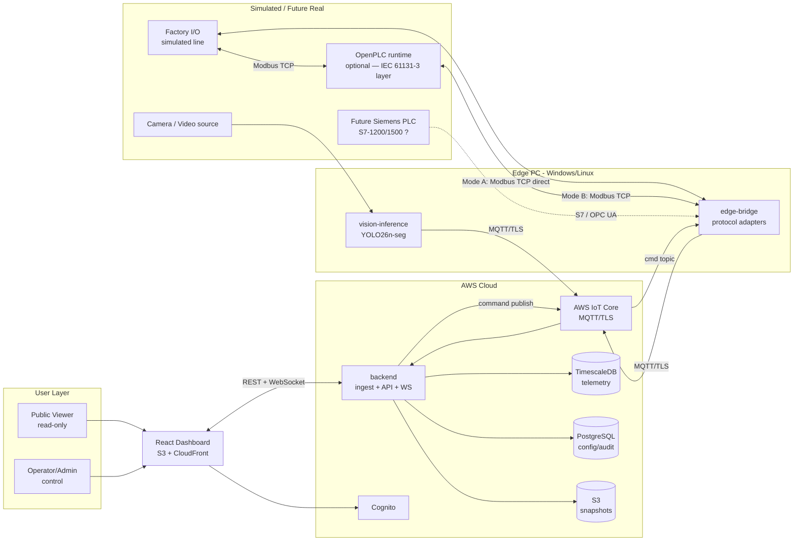
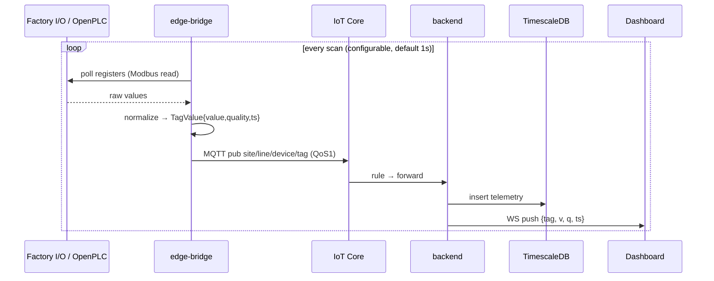
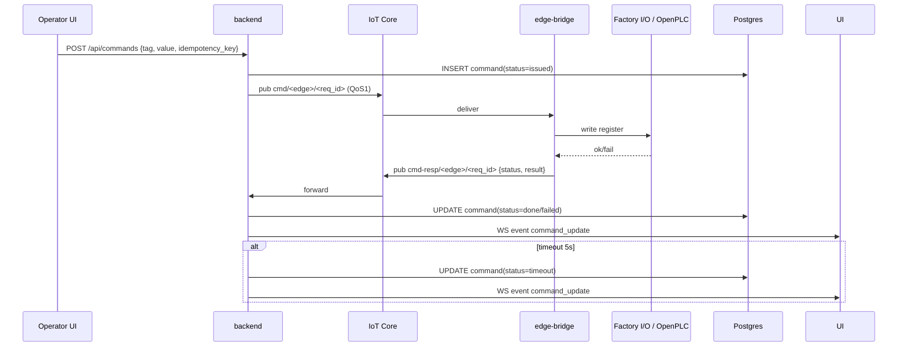

# 02 — Architecture

## 1. C4 Level 1 — System Context

> **สองโหมดการต่อ Factory I/O** (รายละเอียด: เอกสาร 04 §1.5, ที่มา: เอกสาร 14 §1)
> - **Mode A — direct**: edge-bridge poll/write Factory I/O ตรง — ใช้ bring-up/smoke test เท่านั้น เพราะ command ลงถึง actuator โดยไม่มี control layer คั่น
> - **Mode B — through-PLC** ★ default สำหรับ demo/dev: OpenPLC รัน ladder logic จริง (IEC 61131-3), poll Factory I/O เป็น master; edge-bridge คุยกับ OpenPLC (slave) — command จาก cloud ต้องผ่าน PLC decision เหมือนโรงงานจริง และเป็น topology เดียวกับที่จะใช้กับ Siemens ภายหลัง

## 2. Purdue Model Mapping (ความปลอดภัยเชิง zone)

| Purdue Level | ของเราคือ | หมายเหตุ |
|---|---|---|
| L0–L1 (field/control) | Factory I/O sim + OpenPLC (Mode B) / Siemens PLC | ระบบนี้ **ไม่แตะ** safety interlock — อยู่ใน PLC เท่านั้น |
| L2 (supervisory) | edge-bridge + vision-inference | รันบนเครื่องเดียวกับ Factory I/O |
| L3–L3.5 (DMZ) | AWS IoT Core = DMZ จริง | OT network ไม่มี inbound — edge dial-out เท่านั้น |
| L4–L5 (enterprise) | backend, DB, dashboard | IT zone เต็ม |

**กฎเหล็ก**: ไม่มี path ไหนที่เปิด inbound port เข้า OT network — edge bridge เป็น client ตลอด (dial-out only)

## 3. C4 Level 2 — Containers

| Container | Tech | หน้าที่ |
|---|---|---|
| `edge-bridge` | Python 3.12, asyncio | adapters (modbus/s7/opcua/sim) → normalize → MQTT publish; รับ command → write-back |
| `vision-inference` | Python + Ultralytics | YOLO26n-seg จาก Aggregate_Project → publish tag |
| `ingest` | Node.js (NestJS) หรือ FastAPI | subscribe IoT Core → validate → write TimescaleDB → fan-out WS |
| `api` | รวมกับ ingest ใน service เดียวกัน | REST + WebSocket + auth + command orchestration |
| `dashboard` | React + TS + Vite | SPA บน S3+CloudFront |
| `timescaledb` | TimescaleDB (Postgres ext) | telemetry hypertable |
| `postgres` | ใช้ instance เดียวกับ Timescale | users, tags, alarms, commands, audit |
| `iot-core` | AWS managed | broker, device cert, rules engine |
| `cognito` | AWS managed | user pool: operator/admin |

> **ตัดสินใจ**: ingest + api เป็น service เดียว (modular monolith) — ขนาดงานเล็ก ลด ops burden; แยกได้ภายหลังถ้า scale ต้องการ (ดู ADR-05 ใน 03)

## 4. Data Flow — Telemetry (ขึ้น)

## 5. Data Flow — Command (ลง)

## 6. Failure Modes (สำคัญที่สุดของระบบนี้)

| เหตุการณ์ | พฤติกรรมที่ออกแบบ |
|---|---|
| Edge ขาดเน็ต | buffer ลง SQLite local (WAL) → flush เมื่อกลับมา; tag บน dashboard → STALE |
| Broker ล่ม | edge retry with backoff; UI แสดง "connection lost" banner |
| Backend ตาย | CloudFront ยัง serve static; WS reconnect auto; alarm state อยู่ใน DB ไม่หาย |
| Command ค้าง | timeout 5s → mark failed + alert; **ไม่มี** auto-retry บน write |
| คนสั่งพร้อมกัน | idempotency key + advisory lock ต่อ tag |
| PLC จริง disconnect | adapter reconnect loop; tag quality = BAD; ห้าม publish ค่าเก่าเป็น GOOD |

## 7. Boundary สำคัญ

- **ห้าม** frontend รู้จัก Modbus/S7/OPC UA เลย — รู้แค่ normalized tag
- **ห้าม** edge-bridge มี business logic — มันแค่ translate + buffer + relay
- **ทุก** write ต้องผ่าน command pipeline เดียว — ห้าม path ลัด
- vision-inference เป็น **read-only source** — ไม่มีสิทธิ์ write
