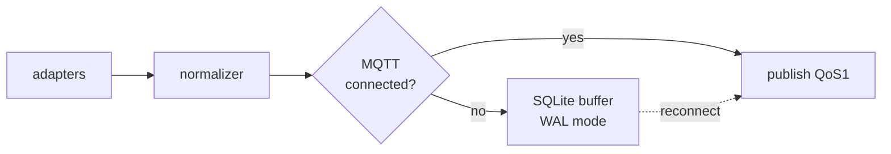

# 04 — Edge Bridge & Protocol Abstraction

## 1. หน้าที่ของ edge-bridge

- รันบนเครื่องเดียวกับ Factory I/O (Windows PC) หรือเครื่องที่เข้าถึง OT network ได้
- Poll/Subscribe tag จาก data source ใดก็ได้ผ่าน **adapter**
- Normalize เป็น `TagValue` กลาง → publish MQTT ขึ้น IoT Core
- รับ command จาก cloud → write-back ผ่าน adapter เดิม
- Buffer ข้อมูลเมื่อขาดเน็ต (store-and-forward)
- **ห้าม** มี business logic — เป็น dumb pipe ที่ฉลาดเรื่อง protocol เท่านั้น

## 1.5 Topology Modes — จุดที่ edge-bridge ต่อเข้า plant

community lab pattern (Factory I/O + OpenPLC) สอนว่ามี 2 วิธีต่อ — ต่างกันที่
"มี controller คั่นไหม" (รายละเอียดและแหล่งอ้างอิง: เอกสาร 14 §1)

```
Mode A — direct (bring-up / smoke test)
  Factory I/O (Modbus server :502) ◄──poll/write── edge-bridge
    • ง่ายสุด ไม่ต้องมี PLC — ใช้ Sprint 0–1
    • ⚠️ command ลงถึง actuator ตรงๆ ไม่มี control layer คั่น
      → ใช้เทส plumbing เท่านั้น ไม่ใช่ topology จริงของโรงงาน

Mode B — through-PLC (demo/production-realistic) ★ แนะนำเป็น default
  Factory I/O (Modbus server) ◄──poll── OpenPLC Runtime (master + slave :502)
                                              ▲
                                              │ poll/write (Modbus TCP)
                                          edge-bridge
    • OpenPLC รัน ladder logic จริง (ภาษา IEC 61131-3 — ST/LD/FBD)
    • edge-bridge คุยกับ OpenPLC (slave server :502) เหมือนคุย PLC จริง —
      adapter เดียวกัน (modbus) ต่างแค่ host/tag map
    • command จาก cloud → register ของ PLC → ladder ตัดสิน
      → สอดคล้องกับ "PLC owns interlock" (เอกสาร 08 §3) โดยโครงสร้าง
    • OpenPLC ฟรี, รัน Docker/Windows/Linux, web IDE แก้ ladder ได้
      — scene เดิมของ Factory I/O ใช้ต่อได้
```

**กฎ**: Mode A ห้ามใช้ใน demo/sprint ที่ต้องโชว์ "สั่งผ่าน PLC" — Mode B
คือ topology ที่จะถ่ายทอดไป Siemens จริง (แค่เปลี่ยน OpenPLC → S7 adapter)

## 2. Adapter Interface (contract เดียวสำหรับทุก protocol)

```python
# edge_bridge/adapters/base.py
from abc import ABC, abstractmethod
from dataclasses import dataclass
from enum import Enum
from datetime import datetime

class Quality(Enum):
    GOOD = "good"
    BAD = "bad"          # connection/device fail — ห้ามแสดงเป็นค่าจริง
    STALE = "stale"      # ไม่เปลี่ยนเกิน deadband timeout
    UNCERTAIN = "uncertain"

@dataclass
class TagValue:
    tag: str                    # normalized name เช่น "line1.conv1.running"
    value: bool | int | float | str
    quality: Quality
    timestamp: datetime         # UTC, source timestamp
    source: str                 # adapter name เช่น "modbus", "s7", "vision"

class TagAdapter(ABC):
    name: str

    @abstractmethod
    async def connect(self) -> None: ...

    @abstractmethod
    async def disconnect(self) -> None: ...

    @abstractmethod
    async def poll(self) -> list[TagValue]:
        """อ่านค่าทุก tag ที่ลงทะเบียนไว้ — คืน quality=BAD ถ้าอ่านไม่ได้"""

    @abstractmethod
    async def write(self, tag: str, value) -> bool:
        """เขียนค่า — return True ถ้า device ack"""

    @abstractmethod
    def tag_map(self) -> dict[str, dict]:
        """normalized tag → address spec ของ protocol นั้น"""
```

### Adapter ที่ต้อง implement

| Adapter | Library | Target |
|---|---|---|
| `modbus` | `pymodbus` | **Factory I/O ตัวแรก** — Factory I/O เป็น Modbus TCP server |
| `sim` | internal | ไม่ต้องมี hardware เลย — generate waveform/สุ่ม |
| `s7` | `python-snap7` | Siemens S7-1200/1500 ผ่าน S7 protocol ตรง |
| `opcua` | `asyncua` | Siemens รุ่นใหม่ (S7-1200 FW≥4.4, S7-1500 FW≥2.0), หรือ OPC server อื่น |

> **ทำไมเลือก Modbus TCP เป็นตัวแรกสำหรับ Factory I/O**:
> ใน Factory I/O config เลือก driver "Modbus TCP/IP Server" → มันเป็น server
> ที่เราเขียน/อ่าน coil+register ได้ — ไม่ต้องมี OPC server คั่นกลาง
> (OPC DA/UA ของ Factory I/O มันเป็น *client* ต้องมี server แยก — เพิ่มความซับซ้อน)

## 3. Tag Mapping (YAML config)

```yaml
# config/tags.modbus.yaml — ตัวอย่างสำหรับ Factory I/O scene "Sorting Station"
adapter: modbus
host: 127.0.0.1        # หรือ IP เครื่องที่รัน Factory I/O / OpenPLC
port: 502
unit_id: 1

# ── connection & retry (field rules — ดู §6.1) ──────────────
connect_timeout_ms: 3000     # TCP connect — >3x normal RTT
request_timeout_ms: 2000     # ต่อ Modbus request — ≥3x normal response
max_retries: 2               # ห้าม retry storm — นับรวม circuit-breaker
retry_backoff_ms: [500, 2000]  # exponential, cap ตาม max_retries
max_pdu_bytes: 240           # ≤253 (Modbus TCP spec) — bound request size
reconnect_backoff_s: [1, 60] # min→max exponential สำหรับ connection drop
poll_ms_default: 1000        # เหตุผล: ช้าที่สุดที่ process ยังรับได้ ไม่ใช่เร็วสุดที่ทำได้

# poll classes — กลุ่มความถี่ (tag เร็วตัวเดียวใน block จะลากทั้ง block)
poll_classes:
  fast:   { interval_ms: 200 }   # running state, interlock-adjacent signals
  normal: { interval_ms: 1000 }  # default — ค่าทั่วไป
  slow:   { interval_ms: 5000 }  # temperature, counter, config echo

tags:
  line1.conv1.running:
    address: "%QX0.0"       # Factory I/O addressing หรือ offset
    type: coil
    unit: bool
    writable: true
    poll_class: fast
  line1.conv1.speed:
    address: "%QW0"
    type: holding_register
    unit: rpm
    writable: true
    poll_class: normal
  line1.sensor1.detected:
    address: "%IX0.0"
    type: discrete_input
    unit: bool
    writable: false
    poll_class: fast
```

**กฎ**:
- `writable: true` เท่านั้นที่ command pipeline จะยอม
- Tag naming: `site.area.line.device.signal` (UNS-style)
- แยก config ต่อ adapter — adapter เปลี่ยน = เปลี่ยนไฟล์ map ไม่แก้ code

## 4. Store-and-Forward



- Buffer: SQLite file `./buffer.db` (WAL), max ~8 ชม. ของ 100 tags/s ≈ 2.9M rows (~200MB) — cap ที่ config
- Flush policy: FIFO batch 500 rows/publish burst, ไม่แย่ง bandwidth กับ live data (live ไปก่อน, buffer ค่อยตาม)
- Timestamp ต้องเป็น **source timestamp** (เวลาที่อ่านได้จริง) ไม่ใช่เวลา flush

## 5. Command Handling บน Edge

```
MQTT sub: cmd/<edge_id>/<request_id>
payload:  {tag, value, issued_at, idempotency_key, ttl_s}
      │
      ▼
┌──────────────────────────────────────────┐
│ 0. TTL check: edge_now > issued_at+ttl_s │──expired──► resp DENIED (detail=ttl_expired)
│    + clock trustworthy? (§6.6)           │──untrusted─► resp DENIED (detail=clock_untrusted)
│ 1. tag อยู่ใน writable list?             │──no───────► resp DENIED (detail=not_writable)
│ 2. adapter write() → bool                │──interlock► resp DENIED (detail=interlock)
│ 3. publish cmd-resp                      │
└──────────────────────────────────────────┘
MQTT pub: cmd-resp/<edge_id>/<request_id>
payload:  {status: done|denied|error, detail, edge_ts}
```

- **ห้าม** edge auto-retry write — write คือสั่งครั้งเดียว ตอบกลับผลทันที
- Idempotency: edge เก็บ `idempotency_key` ล่าสุด N=1000 รายการ — ถ้าเห็นซ้ำตอบกลับผลเดิม ไม่ write ซ้ำ

## 6. Health & Reconnect

- ทุก adapter publish heartbeat `{site}/edge/<edge_id>/heartbeat` ทุก 10s (ตรงกับ topic layout ในเอกสาร 05)
- ถ้า adapter disconnect → ทุก tag ของมัน quality=BAD + heartbeat หยุด → backend mark stale
- Reconnect: exponential backoff 1s→60s max, ไม่จำกัด retry
- **Report-by-exception**: publish เฉพาะเมื่อค่าเปลี่ยนเกิน `deadband` ใน tag config หรือครบ `max_interval` — กัน MQTT message พุ่งเป็น ~$260/เดือน (คำนวณในเอกสาร 10 §10)

## 6.5 Polling Rules — field lessons (อ้างอิงเอกสาร 14 §2)

กฎเหล่านี้มาจากงานจริง (PLCTalk, Niagara/ICS gateway field guide, Modbus Connect) — sim ให้อภัยทุกอย่าง แต่ PLC จริงมี resource จำกัด ตั้งตั้งแต่ตอนนี้จะได้ไม่ต้องแก้ทีหลัง

| กฎ | เหตุผลจากภาคสนาม |
|---|---|
| edge-bridge เป็น **poller เดียว** ต่อ PLC | หลายโปรแกรม poll device เดียวกัน = socket ล้น / ชนกันบน serial line — เกิดจริงในงาน gateway |
| **TCP connection persistent** — reuse ตลอด, open/close เฉพาะตอน drop | per-request connect = latency + socket churn + connection table ของ PLC เต็มเร็ว |
| **Block read** — group contiguous addresses เป็น request เดียว (≤ `max_pdu_bytes`) | request เล็กจำนวนมาก = overhead latency + CPU ฝั่ง PLC |
| **Poll classes + เตือน block promotion** | field pitfall (Niagara N4): tag `fast` ตัวเดียวใน block `slow` ลากทั้ง block ไป poll ถี่ → adapter ต้อง group block ภายใน class เดียวกันเท่านั้น |
| **Timeout ≥ 3× normal response**, retry ≤2 ครั้ง, exponential backoff | timeout สั้นเกิน = false failure; retry มาก = storm ที่ทำ device overload — นับ retry เข้า circuit breaker |
| **Circuit breaker per adapter** — ล้มต่อเนื่อง N ครั้ง → หยุด poll, mark adapter down, backoff ยาว | PLC จริงมี connection ceiling (S7-1200 ~8 connections) — zombie session จาก retry storm กิน table หมด |
| **ช้าสุดที่ process รับได้** ไม่ใช่เร็วสุดที่ทำได้ — `normal=1s` default | PLCTalk rule; poll ถี่เกิน = เสีย CPU/bandwidth โดยไม่เพิ่มความถูกต้องของข้อมูล |
| **Sim ≠ real** | config ที่รันได้กับ Factory I/O (poll ดุ, write ถี่) **ต้อง review ก่อน**เอาไปใช้กับ PLC จริง — sim ไม่บีบ resource |

## 6.6 Clock Discipline — timestamps คือข้อมูล ไม่ใช่แค่ metadata

ทุก `TagValue` เซ็ต `ts` ที่ **edge** (source time) — ถ้า clock ของ edge เพี้ยน
ทั้งระบบเสียความหมาย: chart พลอตผิดเวลา, audit โกหก, TTL command ทำงานผิด

| กฎ | รายละเอียด |
|---|---|
| **NTP บังคับ** | edge host ต้องรัน NTP client (`systemd-timesyncd`/`chronyd`) sync กับ NTP server ที่กำหนด (site NTP หรือ `time.cloudflare.com`/`pool.ntp.org`); deploy doc ต้องเช็ก `timedatectl status` เป็น step หนึ่ง |
| **Drift monitoring** | edge report `clock_offset_ms` ใน heartbeat payload ทุก 10s — ถ้า |offset| > 500ms → heartbeat `status=degraded` + backend แจ้ง `health` event |
| **Stale ด้วยเวลา** | backend mark `stale` เมื่อไม่มี update เกิน `stale_after_s` — วัดจาก **receive-time ของ backend** ไม่ใช่ tag `ts` (กัน edge clock เพี้ยนแล้ว stale detection พังตาม) |
| **TTL command เช็กสองชั้น** | edge เช็ก `issued_at + ttl_s > edge_now` (edge clock) และ backend เช็กก่อน publish — ถ้า edge clock เพี้ยน >1s ระหว่างรอ command → ตอบ `denied: clock_untrusted` แทนที่จะ write |
| **Monotonic สำหรับ interval** | poll interval, timeout, backoff ใช้ monotonic clock (`time.monotonic()`) เสมอ — NTP slew กระโดดต้องไม่ทำให้ poll หยุด/เร่ง |

เหตุผลธุรกิจ: เหตุการณ์ "อุบัติเหตุเกิด 17:02 แต่ log บอก 16:47" ทำ audit/legal defensibility พังทั้งใบ — ต้นทุน NTP ≈ 0 แต่คุ้มค่าข้อมูลทั้งชุด

## 7. Siemens (future) — เส้นทางเปลี่ยน

```
วันนี้:          Factory I/O ── Modbus TCP ──► edge-bridge ──► MQTT
เมื่อมี PLC:     S7-1200 ── S7 (snap7) หรือ OPC UA ──► edge-bridge ──► MQTT
                 (adapter เปลี่ยน, ทุกอย่างข้างบนเหมือนเดิม)
```

สิ่งที่ต้องรู้ตอนได้ PLC จริง (ยังไม่ต้องตอบตอนนี้ — เอกสาร 14 §4 มี checklist เต็ม):

- **รุ่น + firmware** (ตัดสินว่า S7 ตรงหรือ OPC UA) — S7-1200 ต้อง FW ≥4.4 ถึงมี OPC UA server ในตัว; S7-1500 ต้อง FW ≥2.0 + runtime license
- **IP + rack/slot** — rack/slot ผิดคือสาเหตุ connection refused ที่พบบ่อยสุดในหมวด snap7
- **DB layout** — TIA Portal tag table ต้อง map เข้า `tags.s7.yaml`; **ต้องปิด "Optimized block access"** บน DB ที่จะอ่านผ่าน S7 protocol (community pitfall สำคัญ — optimized DB อ่านด้วย absolute address ไม่ได้)
- **PUT/GET access + protection level** — ต้อง enable "Permit access with PUT/GET communication" ใน TIA Portal ไม่งั้น snap7 connect ไม่ได้
- **Connection ceiling** — S7-1200 รับ S7 connection ได้จำกัด (~8); วาง plan ว่า edge-bridge ใช้กี่ช่อง, HMI/SCADA อื่นใช้กี่ช่อง
- **Write permissions** — ยืนยันกับทีม process ว่า tag ไหน writable จริงจาก cloud (ควรเป็น setpoint/mode เท่านั้น ไม่ใช่ interlock)
- **ถ้าเลือก OPC UA**: ค่า license + จำนวน monitored items ที่ server รับ + security policy (Sign & Encrypt)
