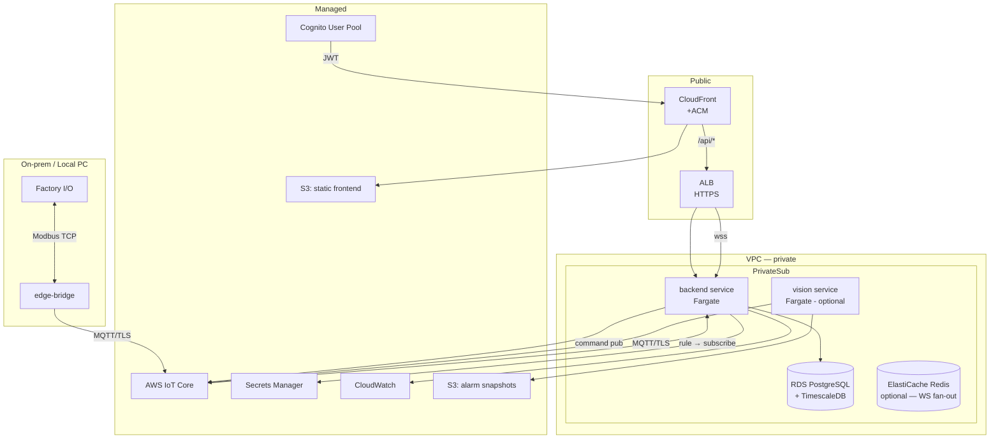

# 10 — AWS Deployment

## 1. Topology



## 2. Service Placement

| Component | Where | Why |
|---|---|---|
| `dashboard` (React build) | S3 + CloudFront | static, cheap, CDN, HTTPS |
| `backend` (API+WS+ingest) | ECS Fargate | long-lived WS+MQTT — Lambda ไม่เหมาะ |
| `vision-inference` | ECS Fargate (task แยก) | CPU/GPU optional; scale แยก |
| `edge-bridge` | on-prem PC | อยู่เครือข่ายเดียวกับ Factory I/O — ไม่ใช่ cloud |
| DB | RDS PostgreSQL + Timescale | managed, backup, private |
| MQTT | AWS IoT Core | managed broker, device cert, rules |
| Auth | Cognito | hosted UI, JWT, group |

## 3. IoT Core Setup

- **Thing**: `edge-bridge-<site>` (1 thing per edge instance)
- **Cert**: X.509 generated → attach policy → attach to thing
- **Policy** (least privilege):
  ```json
  {
    "Version": "2012-10-17",
    "Statement": [{
      "Effect": "Allow",
      "Action": ["iot:Connect","iot:Publish","iot:Subscribe","iot:Receive"],
      "Resource": [
        "arn:aws:iot:*:*:client/edge-bridge-*",
        "arn:aws:iot:*:*:topic/plant1/*",
        "arn:aws:iot:*:*:topic/cmd-resp/edge-bridge-*/*",
        "arn:aws:iot:*:*:topic/cmd/edge-bridge-*/*",
        "arn:aws:iot:*:*:topicfilter/cmd/edge-bridge-*/*"
      ]
    }]
  }
  ```
- **Rule**: `SELECT * FROM 'plant1/#'` → republish ไปยัง backend endpoint หรือลง SQS
  - ทางเลือกง่ายสุด: backend เป็น MQTT client ธรรมดา subscribe `plant1/#` (ไม่ต้องใช้ rule) — เลือกแบบนี้สำหรับ v1
  - ทางเลือก scalable: rule → SQS → backend poll (ถ้า connection ต้อง decouple)
- **MQTT version**: edge client ใช้ **MQTT 3.1.1** (ADR-10) — ครบ feature ที่ใช้, mature ทุก lib; MQTT 5 เมื่อจำเป็นจริง
- **Cert lifecycle**: ดูเอกสาร 08 §6.1 — provision ต่อ device, rotate ≤12 เดือน, Device Defender monitor, revoke runbook; ใช้ fleet provisioning (JITR) เมื่อจำนวน edge โต
- **⚠️ S3 rule trap** (field lesson): ห้ามทำ `rule → S3 per-message` สำหรับ telemetry — ล้าน object = cost ระเบิด + list ช้า; S3 ใช้เฉพาะ vision snapshot (ขนาดใหญ่, ความถี่ต่ำ)
- **Command path alternative**: AWS IoT **Jobs** เป็น managed command channel ที่ track lifecycle/OTA เอง — ไม่เลือกเพราะ contract `cmd/`/`cmd-resp/` ของเราเรียบง่ายกว่าและทำ audit ตรง requirement; พิจารณา Jobs เมื่อ fleet ใหญ่หรือต้อง OTA firmware update จริง (เอกสาร 14 §5)

## 4. RDS / TimescaleDB

- `db.t4g.medium` (dev) → `db.t6g.medium` (prod)
- Extension: `timescaledb`, `pg_stat_statements`
- Multi-AZ: dev=off, prod=on (ถ้าจ่ายได้)
- Backup: daily snapshot, retention 7d
- Parameter: `max_connections` ตาม connection pool

## 5. Networking

```
VPC 10.0.0.0/16
├── public-a  10.0.1.0/24   ← ALB
├── public-b  10.0.2.0/24   ← ALB
├── private-a 10.0.11.0/24  ← ECS, RDS
├── private-b 10.0.12.0/24  ← ECS, RDS
└── NAT Gateway (public-a)  ← outbound for ECS pulling images, Secrets Manager
```

Security groups:
- ALB: inbound 443 from 0.0.0.0/0; outbound to ECS SG
- ECS: inbound from ALB SG only; outbound anywhere
- RDS: inbound 5432 from ECS SG only
- Redis: inbound 6379 from ECS SG only

## 6. CI/CD (GitHub Actions)

```yaml
# .github/workflows/deploy.yml (skeleton)
on: push: { branches: [main, develop] }

jobs:
  test:       # lint, typecheck, unit
  build:      # docker build backend, vision; vite build frontend
  deploy-dev:
    if: github.ref == 'refs/heads/develop'
    steps: terraform apply -target=module.dev
  deploy-prod:
    if: github.ref == 'refs/heads/main'
    environment: production   # manual approval gate
    steps: terraform apply -target=module.prod
```

- Container images → ECR
- Frontend → S3 sync + CloudFront invalidation
- DB migration → run as ECS task (alembic) ก่อน service update
- Rollback: previous task definition + `aws ecs update-service`

## 7. Environments

| Env | Branch | Domain | RDS | Notes |
|---|---|---|---|---|
| dev | develop | dev.example.com | t4g.micro | auto-deploy |
| staging | staging | staging.example.com | t4g.small | ใช้ verify release |
| prod | main | app.example.com | t4g.medium+ | manual approve + rollback plan |

## 8. Secrets

```
Secrets Manager:
  /aggdash/<env>/db-password
  /aggdash/<env>/cognito-client-secret
  /aggdash/<env>/iot-endpoint        (not secret แต่ centralize)
  /aggdash/<env>/jwt-audience
```

- Edge bridge cert เก็บ local บนเครื่อง edge (ไฟล์ `.pem`) — ไม่ใส่ Secrets Manager เพราะ edge ต้องอ่านได้โดยไม่ต้อง auth AWS

## 9. Observability

- CloudWatch log group ต่อ service
- Alarm (CloudWatch): ECS task unhealthy, RDS CPU>80%, IoT message drop, command timeout rate
- Dashboard backend expose `/metrics` (Prometheus format) → scrape ภายหลังถ้าอยากได้ Grafana จริง
- Trace: ใส่ `command_id` / `trace_id` ใน log + WS event → end-to-end trace ได้

## 10. Cost Estimate (dev tier, ประมาณการ)

| Service | ~$/mo |
|---|---|
| CloudFront + S3 | $1–5 |
| ALB | $20 |
| **NAT Gateway** (×1, private subnet egress) | **$32** ← hidden cost ที่ estimate แรกลืม — ECS task ใน private subnet ต้องออกเน็ตผ่าน NAT (pull image, IoT Core, Cognito JWKS); **ประหยัดได้**: ใช้ VPC endpoints (IoT/Cognito/ECR ~$7/endpoint) หรือวาง task ใน public subnet + SG เข้ม (demo-tier เท่านั้น) |
| ECS Fargate (backend 0.25vCPU ×1) | $10 |
| ElastiCache Redis (t4g.micro, WS fan-out) | $12–15 |
| RDS t4g.micro | $15 |
| IoT Core (report-by-exception) | $5–10 |
| Cognito | free tier |
| Secrets/CW | $3–5 |
| **รวม** | **~$85–110** |
| รวม (ถ้าตัด NAT ด้วย VPC endpoints) | ~$60–80 |

### เทียบ managed alternative (ทำไมไม่ใช้)

- **AWS IoT SiteWise + Managed Grafana**: ingestion ~$0.30/ล้าน data points + asset model + Grafana workspace — deployment ขนาดกลางอ้างอิง **$5k–15k/เดือน**, latency 50–200ms, lock-in สูง → ไม่คุ้มที่ workload 100 tags/s และต้องการ custom control/audit/mimic (ดูรายละเอียดในเอกสาร 13)

### กันบิลพุ่ง (สำคัญ)

- 100 tags × publish ทุกวินาทีตลอด = ~260M msg/เดือน ≈ **~$260** ที่ IoT Core เพียงอย่างเดียว
- → edge **ต้อง publish แบบ report-by-exception/deadband** (ส่งเมื่อเปลี่ยนเกิน threshold หรือ timeout) — ลดเหลือ ~$5–30/เดือน
- ตั้ง **AWS Budgets alarm** ที่ $100/เดือน — เตือนก่อนบิลระเบิด

## 11. Edge Deployment

- เป็น Python process บน Windows PC เดียวกับ Factory I/O
- Package เป็น `.exe` (PyInstaller) หรือ Python + venv + service (NSSM/Task Scheduler)
- Config: `config.yaml` + `tags.modbus.yaml` + certs local
- Auto-restart on crash: Task Scheduler "on startup" + restart on failure

## 12. Data Architecture (S3 + TimescaleDB)

### 12.1 Data tiers — อุตสาหกรรมแยก 3 ชั้นเสมอ

| Tier | Store | ข้อมูล | Retention | Latency |
|---|---|---|---|---|
| Hot | RDS PostgreSQL + TimescaleDB | telemetry (hypertable), alarms, commands, audit | 90 วัน raw | <100ms query |
| Warm | S3 (Parquet, partitioned) | telemetry archive ทั้งหมด, alarm snapshots | 1 ปี → Glacier | query ผ่าน Athena |
| Cold | S3 Glacier Deep Archive | compliance archive | 7 ปี (policy) | hours |

### 12.2 S3 layout — data lake convention

```
s3://aggdash-<env>-telemetry/
  site=plant1/area=sort/line=line1/device=conv1/signal=temp_c/
    year=2026/month=01/day=15/part-0001.parquet   ← Hive-style partition keys
s3://aggdash-<env>-vision/
  cam1/2026-01-15T10-30-00Z_alarm-<id>.jpg        ← ต่อ alarm event / on-demand snapshot
s3://aggdash-<env>-static/                        ← React build (CloudFront origin)
s3://aggdash-<env>-deploy/                        ← edge config versions, release artifacts
```

- **Ingest path**: IoT Rule `SELECT * FROM 'plant1/#'` → **Kinesis Firehose** (buffer 60s/5MB) → Parquet+GZIP → S3. Firehose ทำ batching ให้ — ห้าม rule→S3 per-message (§3 trap)
- **Partition projection** ใน Athena — ไม่ต้อง MSCK REPAIR
- **Lifecycle**: Standard → IA @30d → Glacier Instant @90d → Deep Archive @1y → expire @7y
- **Encryption**: SSE-KMS (key แยก per bucket), bucket policy ปิด public, block all public access ON
- **Object Lock (vision bucket)**: compliance mode 30d สำหรับ alarm evidence — audit/legal ใช้ได้

### 12.3 TimescaleDB physical design

```sql
CREATE TABLE tag_history (
  ts      timestamptz NOT NULL,
  tag     text        NOT NULL,   -- UNS name
  v       double precision,
  q       text        NOT NULL CHECK (q IN ('good','bad','stale','uncertain')),
  edge_id text        NOT NULL
);
SELECT create_hypertable('tag_history', 'ts');
SELECT add_retention_policy('tag_history', INTERVAL '90 days');
ALTER TABLE tag_history SET (timescaledb.compress,
  timescaledb.compress_segmentby = 'tag', timescaledb.compress_orderby = 'ts');
SELECT add_compression_policy('tag_history', INTERVAL '7 days');

-- continuous aggregate: dashboards ดูย้อนยาว ไม่ต้อง scan raw
CREATE MATERIALIZED VIEW tag_1min WITH (timescaledb.continuous) AS
  SELECT time_bucket('1 minute', ts) bucket, tag,
         avg(v), min(v), max(v), count(*) FROM tag_history GROUP BY 1, 2;
```

- `alarms`, `commands`, `audit_log` = ตารางปกติ (volume ต่ำ, ไม่ต้อง hypertable)
- Index: `(tag, ts DESC)` สำหรับ latest + `(ts)` สำหรับ range scan — hypertable ทำให้ partition pruning อัตโนมัติ

### 12.4 เหตุผลการเลือก (ADR ย่อย)

- **TimescaleDB ไม่ใช่ Timestream/IoT Analytics**: SQL เดิมจาก SQLite port เกือบตรง, query ยืดหยุ่นกว่า, ไม่ lock-in เชิง engine; Timestream คุ้มเฉพาะถ้าปริมาณสูงมากและอยาก zero-ops
- **Firehose ไม่ใช่ Lambda→S3**: managed batching, no per-invoke cost, Parquet transform ในตัว
- **Athena ไม่ใช่ Redshift**: query น้อย, pay-per-scan; ถ้า analytics หนักค่อยย้าย

## 13. IaC Layout (Terraform)

```
infra/aws/
├── modules/
│   ├── network/     # VPC, subnets, SG, NAT/endpoints
│   ├── iot/         # Thing, cert, policy, rules→Firehose
│   ├── data/        # RDS+Timescale, S3 buckets+lifecycle, Firehose, KMS
│   ├── app/         # ECR, ECS service+task, ALB, target group
│   └── edge-ui/     # S3 static + CloudFront + ACM + OAC
├── envs/{dev,staging,prod}/   # tfvars + backend (S3 state + DynamoDB lock)
└── Makefile         # plan/apply/destroy per env
```

## 14. Tool/Framework เสริมที่แนะนำ (verified กับ stack นี้)

| ชั้น | Tool | เหตุผล |
|---|---|---|
| Frontend build | **Bun** (verified: `bun install`+`bun run build` ผ่าน, ~535ms) | install/build เร็วกว่า npm 3–10×; Dockerfile ยังใช้ node:22 ได้ — bun เป็น dev-side option |
| Schema validate | **zod** (web) / **pydantic** (backend — ใช้แล้ว) | contract types share ได้ |
| UI dense grid | uPlot (ใช้แล้ว) — อย่าเปลี่ยน | เบาสุดสำหรับ time-series |
| Observability | `/metrics` → Prometheus → **Grafana** self-host หรือ CloudWatch | มีใน doc นี้ §9 |
| IaC | Terraform (หรือ CDK ถ้าทีม TS) | doc นี้เลือก Terraform |
| Secrets | AWS Secrets Manager + edge `.pem` local | §8 |
| OT protocol ถัดไป | **pymodbus** (Modbus มี stub แล้ว), **python-snap7** (S7), **asyncua** (OPC UA) | adapter pattern พร้อมรับ |

## 15. Migration Path (sim → real PLC)

| Step | Action |
|---|---|
| 1 | เพิ่ม `tags.s7.yaml` หรือ `tags.opcua.yaml` ใน edge config |
| 2 | เปลี่ยน `adapter: modbus` → `s7`/`opcua` |
| 3 | Map register/DB address → tag name เดิม (ชื่อ tag ไม่เปลี่ยน!) |
| 4 | Deploy edge-bridge build ใหม่ → dashboard เหมือนเดิมทุกอย่าง |
